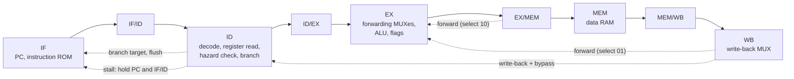
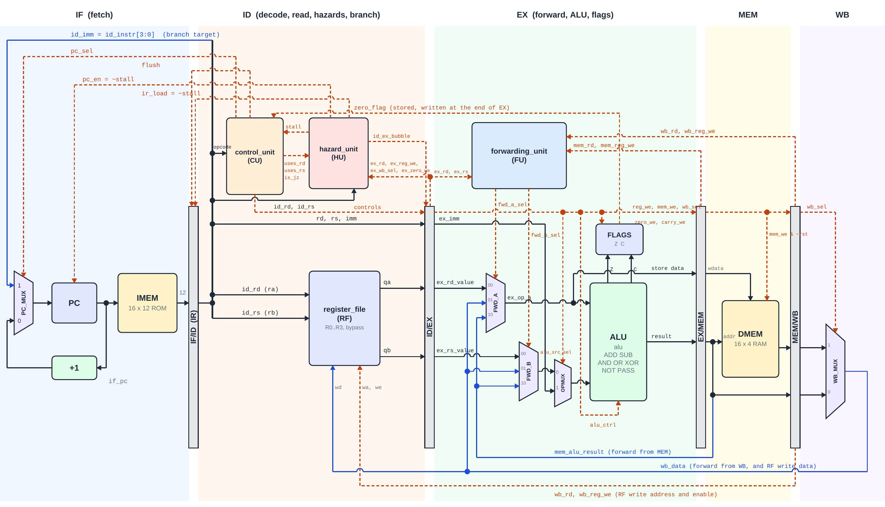
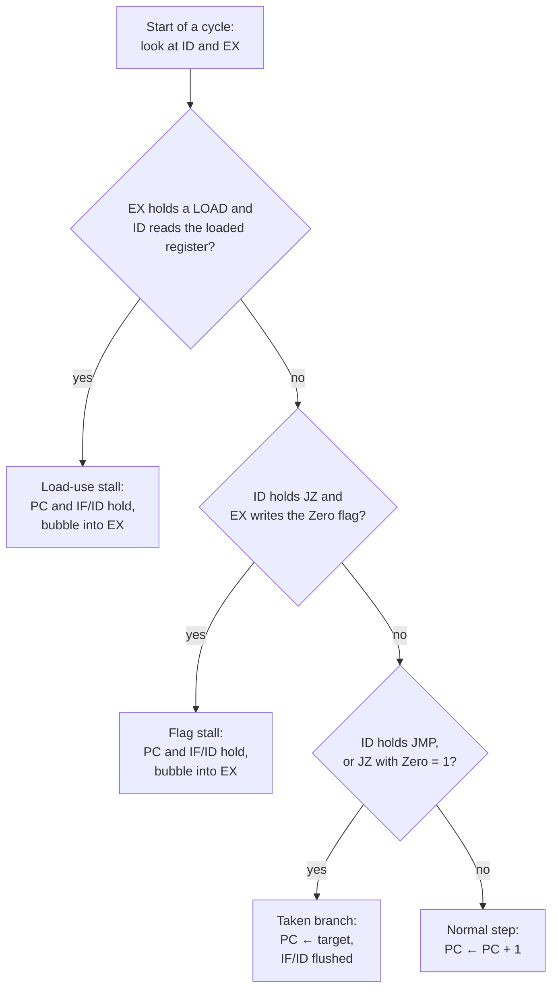

# 4-Bit RISC CPU with a 5-Stage Pipeline

A 4-bit RISC CPU written in Verilog-2001, upgraded from a 3-stage pipeline (IF, ID, EX) to a classic
**5-stage pipeline (IF, ID, EX, MEM, WB)** with **operand forwarding**, a **hazard detection unit**,
a **write-first register file** and **branch resolution in ID**.

> Phase 1 Capstone project · Vu Quoc Anh (SE203519)

---

## Highlights

- **Real pipeline hazards, solved in hardware.** Forwarding from MEM and WB, a write-first bypass in the
  register file, a 1-cycle stall for load-use, and a 1-cycle flag stall for `JZ`.
- **Cheaper branches.** Branches are decided in ID, so a taken branch costs 1 cycle instead of 2.
- **Design on paper before code.** Decisions table, hazard catalog, corner cases, block diagram and full
  netlist were carefully considered before coding.
- **Strict verification.** 16 self-checking testbenches, exhaustive unit tests, lockstep comparison against
  an independent ISA model on 300 random programs, protocol invariants, coverage goals, and mutation testing.
- **Verified in Vivado XSim:** `129 directed + 368830 lockstep + 24942 invariant checks, 0 errors`.

---

## Architecture



| Stage | Job | Main blocks |
|---|---|---|
| **IF** | fetch the word at PC; choose the next PC | `program_counter`, `instruction_memory`, `PC_MUX` |
| **ID** | decode; read Rd and Rs; detect hazards; decide branches | `control_unit`, `register_file`, `hazard_unit` |
| **EX** | pick the newest copy of each operand; compute; set flags | `forwarding_unit`, `mux3` x2, `OPERAND_MUX`, `alu`, `flag_register` |
| **MEM** | read or write the data memory | `data_memory` |
| **WB** | choose the ALU result or the memory data; write Rd | `WB_MUX`, register-file write port |

### Top-level datapath (`cpu_top`)



*Complete datapath of `cpu_top`: every module, every net between them, and every control signal.
Black = data moving forward; blue = data moving backward (forwarding and write-back); orange dashed = control.
A small hump marks 2 wires crossing without connecting; a dot marks a real connection. Lines leaving the top of a
pipeline register are fields stored in it. Not drawn: `clk` and `rst` (to every register), the trace fields and the
debug outputs.*

How to follow it, stage by stage:

- **IF:** PC addresses the ROM and the word goes into IF/ID. `PC_MUX` chooses PC + 1, or the branch target
  `id_imm` when `pc_sel` = 1. `pc_en` and `ir_load` freeze PC and IF/ID during a stall; `flush` empties IF/ID.
- **ID:** the word is split into fields. The control unit decodes the opcode and decides branches; the register
  file reads Rd and Rs; the hazard unit compares the registers ID reads with the instruction in EX.
- **EX:** the forwarding unit chooses, for each operand, the register value, the WB data or the MEM-stage ALU
  result. `OPERAND_MUX` replaces operand B with the immediate for LDI, LOAD and STORE. The ALU computes and
  FLAGS stores Zero and Carry at the end of the cycle.
- **MEM:** the ALU result is the memory address. STORE writes the forwarded Rd value; LOAD reads.
- **WB:** `WB_MUX` picks the ALU result or the memory data; `wb_data` goes to the register-file write port and
  back to the forwarding MUXes.

### Key specifications

| Parameter | Value |
|---|---|
| Data width | 4 bits (registers, ALU, data memory) |
| Registers | R0 to R3; 2 read ports, 1 write port, write-first bypass |
| Instruction | 12 bits: opcode [11:8], Rd [7:6], Rs [5:4], immediate or address [3:0] |
| Memories | instruction ROM 16 x 12 bits, data RAM 16 x 4 bits (Harvard organization) |
| Flags | Zero, and Carry (carry out for ADD, no-borrow for SUB) |
| Reset | synchronous, active high; clears PC, registers, flags and every pipeline register |
| Target | Digilent Basys 3, Artix-7 xc7a35tcpg236-1 |

---

## Instruction set

```
 11      8 7    6 5    4 3          0
+---------+------+------+------------+
| opcode  |  Rd  |  Rs  | imm / addr |
+---------+------+------+------------+
```

| Opcode | Mnemonic | Operation | Reads | Flags |
|---|---|---|---|---|
| `0000` | `ADD Rd, Rs` | Rd ← Rd + Rs | Rd, Rs | Z, C |
| `0001` | `SUB Rd, Rs` | Rd ← Rd − Rs | Rd, Rs | Z, C (no-borrow) |
| `0010` | `AND Rd, Rs` | Rd ← Rd & Rs | Rd, Rs | Z |
| `0011` | `OR Rd, Rs` | Rd ← Rd \| Rs | Rd, Rs | Z |
| `0100` | `XOR Rd, Rs` | Rd ← Rd ^ Rs | Rd, Rs | Z |
| `0101` | `NOT Rd` | Rd ← ~Rd | Rd | Z |
| `0110` | `LDI Rd, imm` | Rd ← imm | none | none |
| `0111` | `MOV Rd, Rs` | Rd ← Rs | Rs | none |
| `1000` | `LOAD Rd, a` | Rd ← dmem[a] | none | none |
| `1001` | `STORE Rd, a` | dmem[a] ← Rd | Rd | none |
| `1010` | `JMP a` | PC ← a | none | none |
| `1011` | `JZ a` | if Z = 1: PC ← a | Zero flag | none |
| `1100`–`1111` | reserved | no operation | none | none |

The format is two-address (`ADD R1, R2` means R1 = R1 + R2), so for hazard detection the "Reads" column
matters most: a data hazard exists only when an instruction reads a register that an older instruction
will write.

---

## Hazard handling

| Producer | Distance to the reader | Mechanism | Cost |
|---|---|---|---|
| ALU instruction | 1 | forward the EX/MEM result (select `10`) | 0 |
| ALU or LOAD | 2 | forward `wb_data` from WB (select `01`) | 0 |
| ALU or LOAD | 3 | write-first bypass inside the register file | 0 |
| any | 4 or more | nothing needed | 0 |
| LOAD | 1 | stall 1 cycle, then forward from WB | 1 cycle |
| flag writer | 1 (reader is `JZ`) | stall `JZ` 1 cycle until the Zero flag is written | 1 cycle |
| taken `JMP` or `JZ` | n/a | decided in ID; flush the 1 instruction fetched behind it | 1 cycle |



The forwarding unit checks the MEM stage before the WB stage, because the instruction in MEM is the newer
one: if both write the same register, the reader must get the value written last in program order.

**Retire rule** used to check every simulation by hand: the k-th instruction retires in cycle
**4 + k + (bubbles before it)**. A stall adds 1 bubble before the stalled instruction; a taken branch adds
1 bubble after the branch.

---

## Design decisions

| # | Decision | Choice | Reason |
|---|---|---|---|
| D2 | where registers are read | in ID | operands are ready at the start of EX |
| D3 | read during a write | write-first bypass in the register file | removes the distance-3 hazard without a 3rd forwarding source |
| D5 | LOAD result | ready only after MEM, 1 stall | keeps the memory out of the EX path |
| D6 | branch decision | in ID | 1 bubble instead of 2 |
| D7 | `JZ` right after a flag writer | stall 1 cycle | keeps the ALU out of the branch path (forwarding the ALU zero into ID is a measured trade-off for later) |
| D9 | reset | synchronous; memory write gated with `~rst` | a STORE caught by reset must not change memory |
| D10 | program ROM | initialized only by `$readmemh` (16 words per file) | simulation and synthesis build the same ROM |
| D11 | shared encodings | 1 header, `cpu_defs.vh` | an opcode or ALU code can never differ between files |

The ALU uses **1 shared adder** for ADD and SUB (`a + ~b + 1`), so the carry out is directly the Carry flag
for ADD and the no-borrow flag for SUB.

---

## Repository structure

```
rtl/            design: 1 module per file, cpu_defs.vh, program.mem (ROM content)
tb/             16 self-checking testbenches, isa_reference_model.v, test programs (*.mem)
constraints/    basys3_cpu_top.xdc (clock, reset button, LEDs, Pmod pins)
docs/           top_level_diagram.png (datapath figure used in this README)
```

### Modules

| Module | Stage | Role |
|---|---|---|
| `program_counter` | IF | fetch address; holds during a stall (`pc_en = ~stall`) |
| `instruction_memory` | IF | 16 x 12-bit program ROM |
| `instruction_register` | IF/ID | IF/ID pipeline register: capture, hold (stall) or flush |
| `control_unit` | ID | hardwired decoder and branch decision |
| `register_file` | ID / WB | R0 to R3 with write-first bypass |
| `hazard_unit` | ID | load-use and flag stalls |
| `id_ex_register` | ID/EX | controls, fields and register values; bubble on stall |
| `forwarding_unit` | EX | operand source selection (MEM, WB or register file) |
| `mux3` | EX | forwarding MUXes for operands A and B |
| `alu` | EX | ADD, SUB, AND, OR, XOR, NOT, PASS; Zero and Carry |
| `flag_register` | EX | Zero and Carry with separate write enables |
| `ex_mem_register` | EX/MEM | ALU result, store data, controls |
| `data_memory` | MEM | 16 x 4-bit RAM for LOAD and STORE |
| `mem_wb_register` | MEM/WB | both possible results into WB |
| `mux2` | IF, EX, WB | PC MUX, operand MUX, write-back MUX |
| `cpu_top` | top | connects the 5 stages; stage-prefixed net names (`if_`, `id_`, `ex_`, `mem_`, `wb_`) |

---

## Verification

| Level | What | Scale |
|---|---|---|
| Unit, exhaustive | every input combination of the combinational modules | ALU 2,048 · hazard unit 4,096 · forwarding unit 1,024 · mux3 16,384 |
| Unit, random | random sequences of the sequential modules against a model | 1,000 to 2,000 cycles each |
| CPU, directed | 5 programs; the retiring instruction is checked every cycle against a hand-made stream | 129 checks |
| CPU, lockstep | every retirement compared with an independent ISA model; 300 random programs | 368,830 comparisons |
| Invariants and coverage | pipeline protocol rules every cycle; 15 coverage goals that must all be hit | every goal reached |
| Mutation | 8 typical design bugs inserted on purpose | 8 of 8 caught |

Every testbench prints the author banner, a Part 1 table of directed cases 10 ns apart, a Part 2 with
exhaustive, random or lockstep checks against an independent reference, and a final `PASS:` or `FAILED:` line.

### Results

| Testbench | Result |
|---|---|
| `tb_alu` | 15 directed + 2048 exhaustive checks, 0 errors |
| `tb_mux2` | 6 directed + 512 exhaustive checks, 0 errors |
| `tb_mux3` | 5 directed + 16384 exhaustive checks, 0 errors |
| `tb_register_file` | 10 directed + 2000 random checks, 0 errors |
| `tb_program_counter` | 8 directed + 1000 random checks, 0 errors |
| `tb_instruction_memory` | 8 directed + 16 exhaustive checks, 0 errors |
| `tb_instruction_register` | 9 directed + 1000 random checks, 0 errors |
| `tb_control_unit` | 22 directed + 64 exhaustive checks, 0 errors |
| `tb_hazard_unit` | 10 directed + 4096 exhaustive checks, 0 errors |
| `tb_forwarding_unit` | 9 directed + 1024 exhaustive checks, 0 errors |
| `tb_id_ex_register` | 6 directed + 1000 random checks, 0 errors |
| `tb_flag_register` | 7 directed + 1000 random checks, 0 errors |
| `tb_ex_mem_register` | 5 directed + 1000 random checks, 0 errors |
| `tb_data_memory` | 8 directed + 2016 random checks, 0 errors |
| `tb_mem_wb_register` | 5 directed + 1000 random checks, 0 errors |
| `tb_cpu` (Vivado XSim) | 129 directed + 368830 lockstep + 24942 invariant checks, 0 errors |

### Coverage reached by the random programs (`tb_cpu`)

| Goal | Count | Goal | Count |
|---|---|---|---|
| forward A from MEM | 1924 | forward A from WB | 1703 |
| forward B from MEM | 1571 | forward B from WB | 1316 |
| register-file bypass (distance 3) | 3220 | load-use stall | 422 |
| flag stall (`JZ`) | 852 | `JMP` taken | 1926 |
| `JZ` taken | 1231 | `JZ` not taken | 457 |
| PC wrap 15 → 0 | 1138 | LOAD / STORE retired | 1620 / 1528 |

### Problems found and fixed during verification

| Problem | Found by | Fix |
|---|---|---|
| A STORE caught by reset still wrote the data memory | random lockstep (no directed test had this case) | memory write enable gated with `~rst` |

---

## Performance:

Cycles until the last useful instruction of each test program retires:

| Program | 3-stage design | 5-stage design |
|---|---|---|
| `program.mem` | 7 | 9 |
| `prog_arith.mem` | 11 | 13 |
| `prog_logic.mem` | 14 | 16 |
| `prog_jump.mem` | 15 | 17 |
| `prog_hazard.mem` | 19 | 22 |

In cycles, the 5-stage design is slower on these short programs: filling 5 stages costs 2 more cycles than
filling 3, and the new stalls cost more than the cheaper branches save. Pipelining can only win through a
higher clock frequency. On `prog_hazard` the 5-stage CPU breaks even when its Fmax is about 16% higher than
that of the 3-stage CPU (19 / 22 = 0.86); for long programs without hazards the cycle ratio approaches 1, so
any Fmax gain becomes a real speed-up.

---

## Author

**Vu Quoc Anh**
