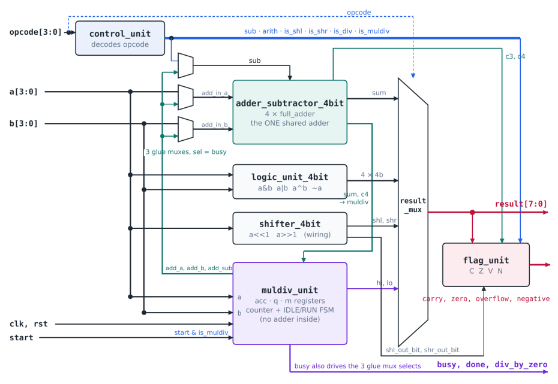
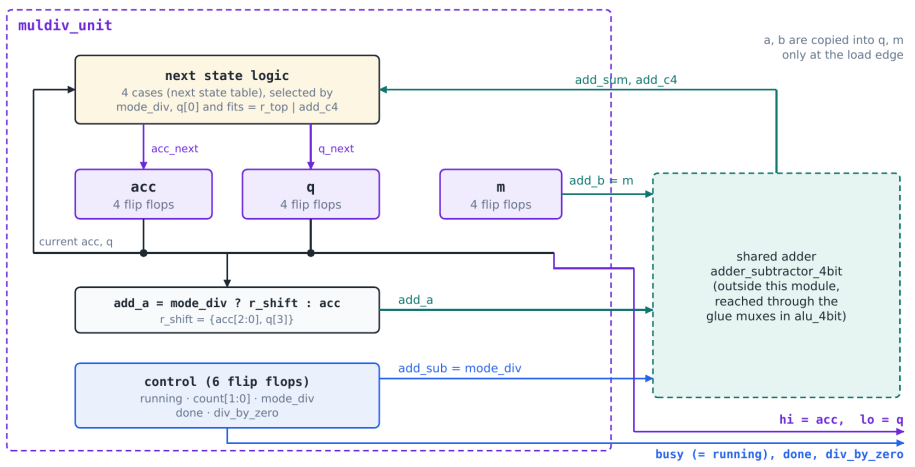
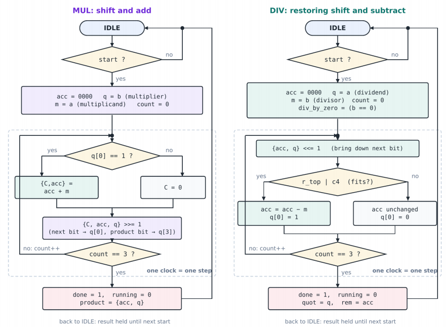

# ALU4: a 4-Bit ALU with Shift-Based Multiply and Divide

A 4-bit arithmetic logic unit with 10 operations: 8 single-cycle operations (ADD, SUB, AND, OR, XOR, NOT,
SHL, SHR) and a sequential multiplier/divider (MUL, DIV) that borrows the ALU's own adder, plus carry,
zero, overflow, negative and divide-by-zero flags.

> Phase 1 Capstone project · Vu Quoc Anh (SE203519)

---

## Highlights

- **1 adder, 2 owners.** MUL and DIV have no adder of their own. 3 multiplexers selected by `busy` lend the
  ALU adder to the multiplier/divider for its 4 step clocks, which saves a second adder (4 full adders and
  4 XOR gates).
- **Small hardware.** 18 flip-flops and 193 two-input gates (Yosys); 62 LUTs, 18 FDCE flip-flops, 30 IOB
  and 1 BUFG on an Artix-7 xc7a35t (Vivado), less than 1% of the device logic.
- **All state in 1 module.** Only `muldiv_unit` is clocked. The other 7 sub-modules are combinational and
  are tested exhaustively.
- **Design on paper before code.** Decisions table, opcode map, port table with "valid when", flag matrix,
  corner cases, block diagram and full netlist were considered before coding.
- **Strong verification.** 9 self-checking testbenches, more than 74,000 checked cases, exhaustive unit tests
  (up to 65,536 cases), protocol checks and mutation testing.
- **Verified in Vivado:** `3584 single cycle + 512 MUL/DIV + protocol checks, 0 errors`.

---

## Architecture

<p align="center">
  
</p>
<p align="center"><em>Figure 1: Top-level block diagram of alu_4bit. The 3 glue muxes (select = busy) lend the adder to muldiv_unit.</em></p>

| Block | Job | Main signals |
|---|---|---|
| **Decode** | turn the opcode into meanings, once | `control_unit`: `sub`, `arith`, `is_shl`, `is_shr`, `is_div`, `is_muldiv` |
| **Compute** | every unit works on a and b at the same time | `adder_subtractor_4bit`, `logic_unit_4bit`, `shifter_4bit`, `muldiv_unit` |
| **Select** | pick the answer named by the opcode, 8 bits wide | `result_mux` |
| **Evaluate** | compute the flags of the selected result | `flag_unit` |
| **Share** | give the adder to whoever needs it this clock | 3 glue MUXes in `alu_4bit`, selected by `busy` |

### Key specifications

| Parameter | Value |
|---|---|
| Operand width | 4 bits (`a`, `b`) |
| Result width | 8 bits (4-bit answers zero-extended; MUL product 8 bits; DIV `{remainder, quotient}`) |
| Opcode | 4 bits: 10 operations, 6 unused codes (result 0) |
| Flags | carry, zero, overflow, negative, div_by_zero (combinational, no flag register) |
| Latency | single-cycle operations: 1 combinational pass; MUL/DIV: 5 clocks (1 load + 4 steps), `busy` high for 4 |
| Reset | asynchronous, active high; clears the MUL/DIV registers, `busy`, `done`, `div_by_zero` |
| Ports | 15 inputs (`clk`, `rst`, `start`, `a`, `b`, `opcode`) and 15 outputs |
| Target | Artix-7 xc7a35t (Basys 3), 100 MHz clock constraint |

---

## Operation set

| Opcode | Mnemonic | Operation | result[7:0] | Flags | Cycles |
|---|---|---|---|---|---|
| `0000` | `ADD` | a + b | `{0000, a+b}` | C, Z, V, N | 1 |
| `0001` | `SUB` | a − b = a + ~b + 1 | `{0000, a−b}` | C (no-borrow), Z, V, N | 1 |
| `0010` | `AND` | a & b | `{0000, a&b}` | Z, N | 1 |
| `0011` | `OR` | a \| b | `{0000, a\|b}` | Z, N | 1 |
| `0100` | `XOR` | a ^ b | `{0000, a^b}` | Z, N | 1 |
| `0101` | `NOT` | ~a (b ignored) | `{0000, ~a}` | Z, N | 1 |
| `0110` | `SHL` | a << 1, logical | `{0000, a<<1}` | C (bit out), Z, N | 1 |
| `0111` | `SHR` | a >> 1, logical | `{0000, a>>1}` | C (bit out), Z, N | 1 |
| `1000` | `MUL` | a × b, unsigned | product[7:0] | Z | 1 + 4 |
| `1001` | `DIV` | a ÷ b, unsigned | `{remainder, quotient}` | Z, div_by_zero | 1 + 4 |
| `1010`–`1111` | reserved | none | `0000_0000` | Z = 1 | none |

Codes that share hardware differ only in bit 0 (ADD/SUB `000x`, SHL/SHR `011x`, MUL/DIV `100x`), so they are
neighbors on a Karnaugh map: `arith = ¬op3·¬op2·¬op1` and `is_muldiv = op3·¬op2·¬op1` are single 3-input ANDs,
and ADD/SUB share 1 branch of the result multiplexer.

---

## Flags

| Flag | Meaning | Equation | Interpretation |
|---|---|---|---|
| `carry` (C) | ADD: carry out of bit 3 · SUB: 1 = no borrow (a ≥ b) · SHL/SHR: the bit shifted out | `arith·c4 + is_shl·a[3] + is_shr·a[0]` | unsigned |
| `overflow` (V) | result outside −8 to +7 (ADD/SUB only) | `arith·(c3 ⊕ c4)` | signed |
| `zero` (Z) | all 8 result bits are 0 | `~\|result` | both |
| `negative` (N) | sign bit of the 4-bit result; 0 for MUL/DIV | `¬is_muldiv·result[3]` | signed |
| `div_by_zero` | the DIV that produced the result had b = 0 | `is_div·md_dbz` | status |

| Example | result | C | V | N | Z | Reading |
|---|---|---|---|---|---|---|
| ADD 5 + 3 | `0000_1000` | 0 | 1 | 1 | 0 | unsigned 8 is correct; signed +8 overflows |
| ADD 15 + 1 | `0000_0000` | 1 | 0 | 0 | 1 | unsigned 16 overflows; signed −1 + 1 = 0 is correct |
| SUB 3 − 5 | `0000_1110` | 0 | 0 | 1 | 0 | borrow (unsigned); signed −2 is correct |
| MUL 15 × 15 | `1110_0001` | 0 | 0 | 0 | 0 | result[7] = 1 but N = 0 (unsigned) |
| DIV 9 ÷ 0 | `1001_1111` | 0 | 0 | 0 | 0 | defined result: quotient 1111, remainder a, div_by_zero = 1 |

---

## Multiply and divide

<p align="center">
  
</p>
<p align="center"><em>Figure 2: muldiv_unit datapath. acc, q and m (12 flip-flops) plus 6 control flip-flops; the adder is outside the module and is reached through the glue muxes in alu_4bit.</em></p>

<p align="center">
  
</p>
<p align="center"><em>Figure 3: muldiv_unit algorithms: MUL shift and add (left), DIV restoring shift and subtract (right). One pass through the dashed box is one clock.</em></p>

| Example | Steps (acc, q after each edge) | Result |
|---|---|---|
| MUL 13 × 11 | load 0000 1011 → 0110 1101 → 1001 1110 → 0100 1111 → 1000 1111 | `1000_1111` = 143 |
| DIV 13 ÷ 4 | load 0000 1101 → 0001 1010 → 0011 0100 → 0010 1001 → 0001 0011 | quotient 3, remainder 1 |

**Protocol:** set `opcode` to MUL or DIV, hold `start = 1` for 1 rising edge, wait for `done = 1`, and read
`result` while the opcode is still MUL/DIV. Do not use ADD/SUB while `busy = 1`: the adder is lent to
`muldiv_unit` and ADD would show its partial sum.

---

## Design decisions

| # | Decision | Choice | Reason |
|---|---|---|---|
| D1 | organization | compute everything, select 1 answer | no enables; only the final MUX depends on the opcode |
| D2 | adder for MUL/DIV | borrow the ALU adder, selected by `busy` | the adder is idle during MUL/DIV; saves 4 full adders + 4 XOR gates |
| D3 | where the state lives | only in `muldiv_unit` | every other module is combinational and exhaustively testable |
| D4 | opcode encoding | pairs that differ only in bit 0 | smaller decoder; ADD/SUB and MUL/DIV share MUX branches |
| D5 | MUL/DIV structure | sequential shift-and-add / restoring shift-and-subtract | 1 4-bit adder instead of an array of about n² cells; costs 4 clocks |
| D6 | MUL carry | no carry flip-flop: add and shift on the same edge | c4 goes straight into acc[3]; saves 1 flip-flop and 1 clock per step |
| D7 | operation select | `mode_div` latched at the load edge | a change of opcode in the middle cannot change the algorithm |
| D8 | `start` | gated with `is_muldiv` in the top level | a start pulse with ADD cannot start a multiply in the background |
| D9 | divide by zero | defined result + `div_by_zero`, gated with `is_div` | no exception mechanism in a bare ALU; 0 always "fits" |
| D10 | flags | combinational, no flag register | storing flags is the job of the processor around the ALU |
| D11 | `r_top` in `fits = r_top \| add_c4` | kept, although provably always 0 | 1 OR gate; correct if the dividend is widened to 8 bits |

The adder computes SUB as `a + ~b + 1`, so the carry out `c4` is directly the Carry flag for ADD, the
no-borrow flag for SUB, the carry into acc[3] for MUL, and the "fits" test for DIV.

---

## Repository structure

```
docs/images/    block diagram, muldiv datapath and flowchart used in this README
rtl/            design: 1 module per file, header comment with job, ports and author
tb/             9 self-checking testbenches (tb_<module>.v)
constraints/    alu4_timing.xdc (100 MHz clock; no pin constraints)
scripts/        Icarus regression, Vivado project, synthesis/utilization report scripts
```

### Modules

| Module | Kind | Role |
|---|---|---|
| `full_adder` | comb. | add 3 bits with propagate/generate; 5 gates |
| `adder_subtractor_4bit` | comb. | 4-bit ripple adder/subtractor (XOR on b, sub as carry in); exports c3 and c4 |
| `logic_unit_4bit` | comb. | AND, OR, XOR, NOT in parallel; 4 slices, 16 gates |
| `shifter_4bit` | wiring | SHL/SHR by 1 and the shifted-out bits; 0 gates |
| `control_unit` | comb. | opcode → 6 control signals, 1 AND term each |
| `result_mux` | comb. | opcode-selected 8-bit result; default branch, no latch |
| `flag_unit` | comb. | carry, zero, overflow, negative |
| `muldiv_unit` | sequential | 2-state FSM + 2-bit counter; acc, q, m and status (18 flip-flops) |
| `alu_4bit` | top | 7 instances, 3 adder-sharing MUXes, start and div_by_zero gating |

---

## Verification

| Level | What | Scale |
|---|---|---|
| Unit, exhaustive | every input combination of the combinational modules | adder 512 · logic 256 · shifter 16 · control 16 · flag unit 65,536 |
| Unit, random | independent random values on all 9 data inputs per opcode | result_mux 3,200 |
| Unit, sequential | all (a, b) pairs for MUL and DIV, latency, busy length, protocol | muldiv_unit 512 operations |
| System, exhaustive | every opcode × every (a, b) against a reference model | 3,584 single cycle + 512 MUL/DIV |
| System, protocol | start ignored for other opcodes, adder returned after MUL, div_by_zero gating, reset | all pass |
| Mutation | 7 changes inserted on purpose | 6 of 6 real bugs caught; 1 equivalent change |

Every testbench prints the author banner, a Part 1 table of directed cases 10 ns apart (timestamps match the
waveform), a Part 2 with exhaustive, random or protocol checks against an independent reference, and a final
`PASS:` or `FAILED:` line. Clocked testbenches drive inputs on the falling edge, so they never race the design.

### Results

| Testbench | Part 1 (printed) | Part 2 (checked) | Result |
|---|---|---|---|
| `tb_full_adder` | 8-row truth table | 8 exhaustive | 0 errors |
| `tb_adder_subtractor_4bit` | 6 carry traces | 512 exhaustive | 0 errors |
| `tb_logic_unit_4bit` | 4 directed pairs | 256 exhaustive | 0 errors |
| `tb_shifter_4bit` | 16 inputs | 16 exhaustive | 0 errors |
| `tb_control_unit` | 16-opcode decode table | 16 exhaustive | 0 errors |
| `tb_result_mux` | 16-opcode selection table | 3,200 random | 0 errors |
| `tb_flag_unit` | 7 realistic cases | 65,536 exhaustive | 0 errors |
| `tb_muldiv_unit` | step tables 13 × 11, 13 ÷ 4, 9 ÷ 0 | 512 operations + protocol | 0 errors |
| `tb_alu_4bit` (Vivado XSim) | 15-row example table | 3,584 single cycle + 512 MUL/DIV + protocol | 0 errors |

### Mutation tests

| Injected bug | Caught by | Result |
|---|---|---|
| overflow = arith·c4 instead of arith·(c3 ⊕ c4) | `tb_flag_unit` / `tb_alu_4bit` | 16,384 / 256 errors |
| arith decoded as opcode == 0000 only | `tb_control_unit` | 1 error |
| adder b input not shared (b connected directly) | `tb_alu_4bit` | 225 errors |
| negative not forced to 0 for MUL/DIV | `tb_alu_4bit` | 128 errors |
| last step at count == 2 instead of 3 | `tb_muldiv_unit` | 517 errors |
| full adder carry OR replaced by AND | `tb_full_adder` | 4 errors |
| fits = add_c4 (r_top removed) | none | PASS: functionally equivalent (proof below) |

### Problems found and fixed during verification

| Problem | Found by | Fix |
|---|---|---|
| The reference says the shifted DIV remainder can reach 29 (5 bits); in fact `r_top` is never 1 for a 4-bit dividend (remainder ≤ 7 before the last step) | hand traces, a monitor in `tb_muldiv_unit` ("r_top was 1 in 0 of 1032 DIV steps"), mutation test | kept `r_top` with a comment; it is needed only for an 8-bit dividend |
| Testbench inputs changing on the sampling edge could race the design | review of the clocked testbenches | inputs driven on the falling edge, checked after the rising edge |

---

## Resources and timing

| Tool | Logic | Flip-flops | Other |
|---|---|---|---|
| Yosys (2-input gate mapping) | 193 gates: 55 AND, 50 NAND, 44 MUX, 16 OR, 9 NOR, 7 XOR, 7 NOT, 5 XNOR | 18 (17 with enable, 1 without) | none |
| Vivado, xc7a35t | 62 LUTs + 1 F7 MUX (< 1%) | 18 FDCE, all in `u_muldiv` | 30 IOB, 1 BUFG |

| Operation | Latency |
|---|---|
| ADD, SUB, AND, OR, XOR, NOT, SHL, SHR | 1 combinational pass (no clock) |
| MUL, DIV | 5 rising edges (50 ns at the 100 MHz constraint), `busy` high for 4 clocks |

The flip-flop count is exactly the register plan: acc 4, q 4, m 4, count 2, running, mode_div, done and
div_by_zero. Vivado reports LUTs, not gates: 1 six-input LUT replaces about 3 two-input gates.

---

## Author

**Vu Quoc Anh**
