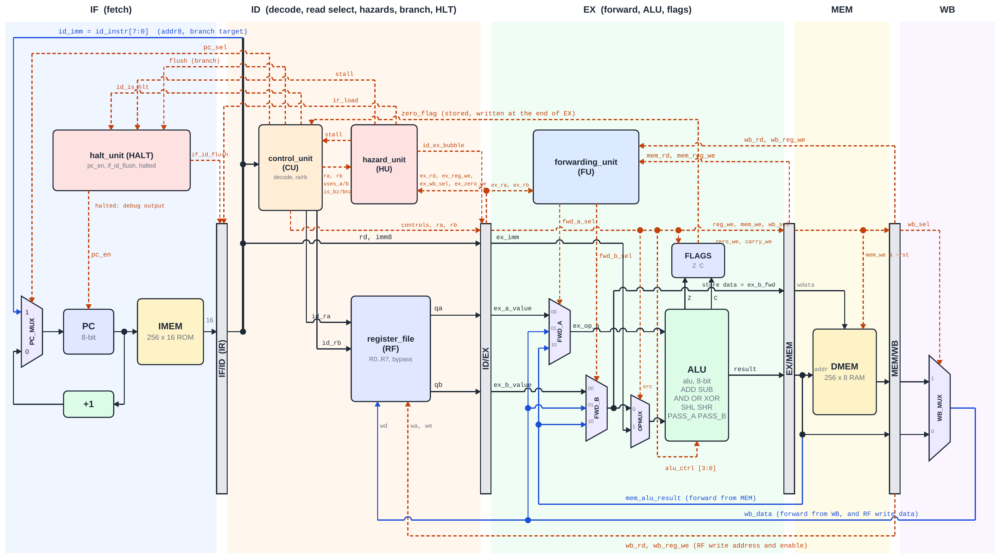
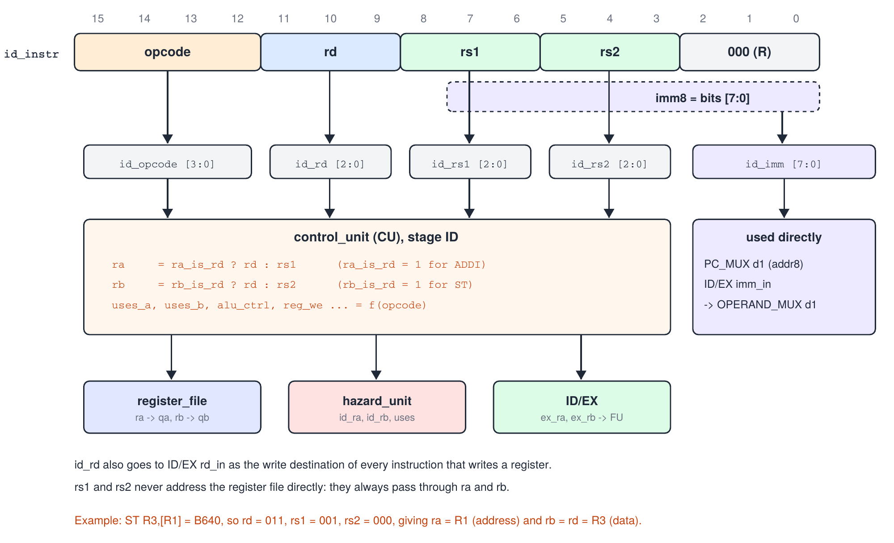
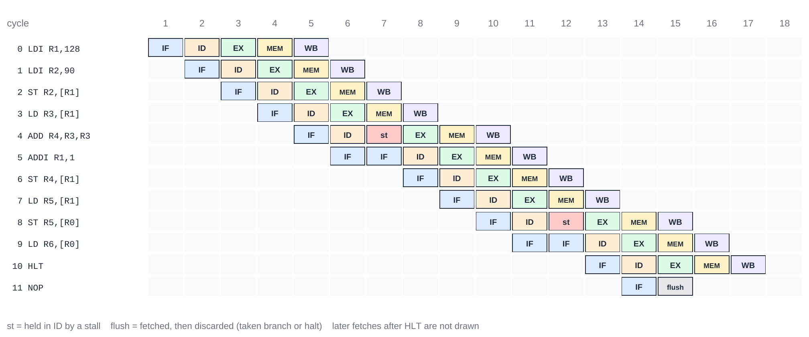

# 8-Bit RISC CPU with a 5-Stage Pipeline


-orange)


A synthesizable 8-bit RISC processor core in Verilog-2001 with a classic **IF, ID, EX, MEM, WB** pipeline.
The core implements a 16-instruction, 3-address ISA with register-indirect memory access, and it resolves
every data and control hazard in hardware: forwarding from MEM and WB, a write-first register file,
load-use and flag stalls, branches decided in ID, and a halt instruction that drains the pipeline safely.

Every design decision was written down before the RTL, and the design is verified at 6 levels, from
exhaustive unit tests to lockstep comparison against an independent ISA model and mutation testing.

> Vu Quoc Anh (SE203519) · Capstone 2, VLSI Design Program · Lecturer: Shivashish Pal

---

## Highlights

- **Instruction-dependent register reads.** The decoder chooses which register each read port reads
  (`rd` for `ADDI` and for the data of `ST`), and flags whether each port is really used. Hazard detection
  and forwarding compare only the registers that are actually read.
- **No false stalls.** The 8-bit immediate overlaps the `rs1` and `rs2` fields; the `uses_a` / `uses_b` flags
  keep bits of a constant from triggering stalls.
- **Register-indirect load and store.** Addresses come from registers and are forwarded like any operand;
  a `ST` can receive a forwarded address and forwarded data in the same cycle.
- **Branches decided in ID.** A taken `JMP`, `BZ` or `BNZ` costs exactly 1 cycle.
- **Safe halt.** `HLT` is decided in ID, freezes fetch and lets older instructions retire. A `HLT` fetched on a
  wrong path is flushed before it can stop the CPU.
- **Predictable timing.** For 6 test programs, the cycle in which `HLT` retires was predicted by hand
  (`4 + k + bubbles`) before simulation, and all 6 predictions match.
- **Toolchain included.** A 2-pass Python assembler turns readable assembly into 256-word ROM images.

---

## Architecture



*Black: data moving forward. Blue: data moving backward (forwarding and write-back). Orange dashed: control.*

| Stage | Function | Main blocks |
|---|---|---|
| **IF** | fetch the word at PC; choose PC + 1 or the branch target | `program_counter`, `instruction_memory`, `PC_MUX` |
| **ID** | decode; select and read registers; detect hazards; decide branches and halt | `control_unit`, `register_file`, `hazard_unit`, `halt_unit` |
| **EX** | select the newest operand copies; compute; update flags | `forwarding_unit`, `mux3` x2, `OPERAND_MUX`, `alu`, `flag_register` |
| **MEM** | read or write data memory | `data_memory` |
| **WB** | choose ALU result or memory data; write the register file | `WB_MUX`, register-file write port |

| Parameter | Value |
|---|---|
| Data width | 8 bits |
| Registers | R0 to R7, 8 bits each (R0 is an ordinary register) |
| Instruction | 16 bits, 1 word per instruction |
| Memories | 256 x 16-bit instruction ROM, 256 x 8-bit data RAM (Harvard) |
| Flags | Z, and C (carry for ADD/ADDI, borrow for SUB, shifted-out bit for SHL/SHR) |
| Reset | synchronous, active high; data-memory writes are blocked during reset |

---

## Instruction set

```
 15    12 11   9 8    6 5    3 2    0
+--------+------+------+------+------+
| opcode |  rd  | rs1  | rs2  | 000  |   R format
+--------+------+------+------+------+
| opcode |  rd  | -  |   imm8/addr8  |   I and J formats (imm8 overlaps rs1 and rs2)
+--------+------+----+---------------+
```

| Op | Instruction | Operation | Flags |
|---|---|---|---|
| 0 | `NOP` | no operation (also the pipeline bubble, word `0000`) | – |
| 1 | `ADD rd, rs1, rs2` | rd = rs1 + rs2 | Z, C |
| 2 | `SUB rd, rs1, rs2` | rd = rs1 − rs2 | Z, C (borrow) |
| 3, 4, 5 | `AND`, `OR`, `XOR rd, rs1, rs2` | bitwise | Z |
| 6, 7 | `SHL`, `SHR rd, rs1` | shift by 1 | Z, C = shifted-out bit |
| 8 | `LDI rd, imm8` | rd = imm8 | – |
| 9 | `ADDI rd, imm8` | rd = rd + imm8 | Z, C |
| A | `LD rd, [rs1]` | rd = dmem[rs1] | – |
| B | `ST rd, [rs1]` | dmem[rs1] = rd | – |
| C | `JMP addr8` | PC = addr8 | – |
| D, E | `BZ`, `BNZ addr8` | branch if Z = 1 / Z = 0 | – |
| F | `HLT` | stop fetching; older instructions finish | – |



*Each field becomes a wire of `cpu_top`; the decoder turns `rd`, `rs1` and `rs2` into the read addresses `ra` and `rb`.*

---

## Hazard handling

| Hazard | Mechanism | Cost |
|---|---|---|
| ALU result needed 1 or 2 instructions later | forwarding from MEM or WB (MEM has priority) | 0 |
| result needed 3 instructions later | write-first bypass in the register file | 0 |
| `LD` result needed by the next instruction (any port, including store data and addresses) | 1-cycle load-use stall, then forwarding from WB | 1 cycle |
| `BZ` / `BNZ` right after an instruction that writes Z | 1-cycle flag stall | 1 cycle |
| taken branch | decided in ID, 1 fetched word flushed | 1 cycle |
| `HLT` | PC frozen, IF/ID flushed, pipeline drains | – |

A stall holds PC and IF/ID and inserts a bubble into ID/EX. Because the bubble writes nothing, the stall
condition clears by itself after exactly 1 cycle.



*Pipeline chart generated from simulation: load-use stalls on port A (cycle 7) and on the store-data port B
(cycle 12); `HLT` retires in cycle 17 = 4 + 11 instructions + 2 bubbles.*

---

## Verification

| Level | Method | Scale |
|---|---|---|
| Unit, exhaustive | every input combination of `alu`, `mux2`, `control_unit`, `hazard_unit`, `forwarding_unit` | up to 655,360 cases |
| Unit, random | sequential modules and `mux3` against reference models | 2,000 to 100,000 cases |
| CPU, directed | 6 programs: every retirement, the `HLT` cycle and the drain checked against hand calculations | 115 checks |
| CPU, lockstep | every retirement compared with an independent ISA model, on 300 random programs | 52,079 comparisons |
| Invariants and coverage | pipeline protocol rules every cycle; 20 coverage goals (every hazard type) | all goals reached |
| Mutation testing | 12 typical design bugs inserted one at a time | 12 of 12 detected |

```
PASS: tb_cpu (Vu Quoc Anh, SE203519) 115 directed + 52079 lockstep + 22383 invariant checks, 0 errors
```

All 17 testbenches pass in Icarus Verilog, and Verilator `-Wall` reports no warnings.

| Program | Focus | CPI after pipeline fill |
|---|---|---|
| `demo`, `prog_arith`, `prog_logic` | forwarding, arithmetic, shifts | 1.00 |
| `prog_mem` | register-indirect memory, load-use stalls | 1.18 |
| `prog_branch` | loop with `BNZ`, flag stalls and flushes | 1.52 |

---

## Synthesis

Yosys (`synth_xilinx -family xc7`) maps the design to **180 flip-flops and 233 LUTs**, with the data memory as
distributed RAM and **no latches or combinational loops**. Vivado project, timing and bitstream scripts are
provided for the Digilent Basys 3 board.

---

## Repository structure

```
rtl/          17 modules, shared header cpu_defs.vh, program.mem
tb/           17 self-checking testbenches, independent ISA reference model, test programs
asm/          assembly sources of the test programs
scripts/      asm8.py (assembler), regression scripts, mutation_test.py, Vivado Tcl scripts
constraints/  basys3_cpu_top.xdc (43 debug outputs on LEDs and Pmods)
docs/         figures used in this README
```

## Quick start

```bash
./scripts/run_all_icarus.sh          # assemble, lint and run all 17 testbenches
python3 scripts/mutation_test.py     # insert 12 bugs and confirm that each one is detected
python3 scripts/asm8.py asm/demo.asm rtl/program.mem   # assemble a program
```

---

**Author:** Vu Quoc Anh (SE203519) · Capstone 2, VLSI Design Program · Lecturer: Shivashish Pal
