# RISC-8 SoC: Pipelined CPU with Interrupts, 8-bit Timer and SAR ADC


A small system on chip built around an 8-bit, 5-stage pipelined RISC CPU. The CPU was extended with precise interrupts, 4 new instructions and a memory-mapped I/O port, and it controls an 8-bit peripheral that contains a timer with PWM, a successive approximation (SAR) ADC controller, an 8-entry result FIFO and 7 interrupt sources.

The RTL is plain Verilog 2001 and synthesizable. The verification side is the larger half of the project. It combines exhaustive unit tests, random tests against independent reference models, lockstep checking of the CPU at the instruction level, a system test driven by real firmware, 34 SystemVerilog assertions, a UVM environment with a register model, a scoreboard that predicts every clock and functional coverage, and mutation testing that proves the tests detect real bugs.

**Author:** Vu Quoc Anh (SE203519)

---

## Contents

1. [Results at a glance](#1-results-at-a-glance)
2. [System architecture](#2-system-architecture)
3. [The CPU](#3-the-cpu)
4. [The peripheral](#4-the-peripheral)
5. [The interrupt mechanism end to end](#5-the-interrupt-mechanism-end-to-end)
6. [Firmware and the system test](#6-firmware-and-the-system-test)
7. [Verification methodology](#7-verification-methodology)
8. [Design decisions](#8-design-decisions)
9. [Repository structure](#9-repository-structure)
10. [How to run](#10-how-to-run)
11. [Documentation](#11-documentation)

---

## 1. Results at a glance

| Item | Result |
|---|---|
| Directed and unit testbenches (Icarus Verilog 12) | 25 of 25 PASS, 0 errors |
| CPU lockstep against an ISA model, with random interrupts | 400 random programs, 146,060 comparisons, 0 errors |
| System test (firmware on the full SoC) | 25 of 25 checks PASS, under Icarus and under Verilator |
| SystemVerilog assertions bound to the peripheral | 34 rules, 0 failures during the system test |
| UVM regression (Verilator 5.054 with the Accellera UVM library) | 12 of 12 tests PASS, 100 % functional coverage in all 5 groups |
| Mutation testing | 16 of 16 inserted bugs detected, each by a FAIL and none by a timeout |
| Lint (Verilator) | 0 warnings on the full SoC |
| CPU sleeping in the demo firmware (WFI with a watermark interrupt) | 743 of 1203 cycles (62 %) |

---

## 2. System architecture

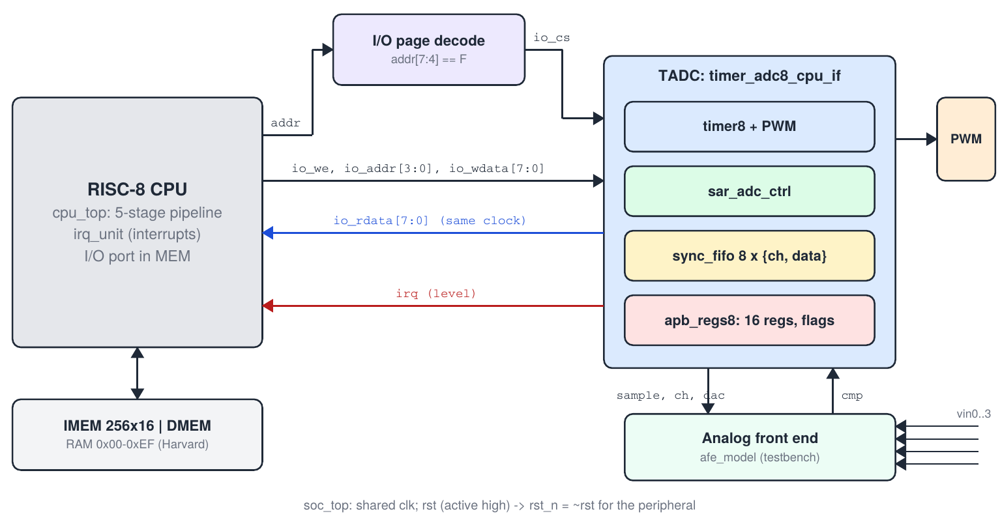

The CPU sees the peripheral as 16 bytes of memory at addresses `0xF0` to `0xFF`. A store (`ST`) to `0xF0 + n` writes register `n` and a load (`LD`) from `0xF0 + n` reads it. Every access takes exactly 1 clock, because the read path of the peripheral is combinational, so the CPU needs no wait states. The peripheral calls the CPU with a single wire, `irq`, which is a level signal. In simulation the analog front end (multiplexer, sample and hold, DAC and comparator) is a behavioral model inside the testbench.

### Ports of `soc_top`

| Port | Dir | Width | Meaning |
|---|---|---|---|
| `clk` | in | 1 | the single clock of the whole system |
| `rst` | in | 1 | synchronous reset, active high. The peripheral receives `rst_n = ~rst` |
| `halted` | out | 1 | 1 after `HLT`, the CPU has stopped fetching |
| `pc_out` | out | 8 | fetch address, for debugging |
| `irq` | out | 1 | interrupt request, also visible outside |
| `pwm_out` | out | 1 | timer PWM output |
| `adc_sample` | out | 1 | 1 means the sample and hold circuit tracks the input, 0 means it holds |
| `adc_ch` | out | 2 | which of the 4 analog inputs the multiplexer selects |
| `adc_dac` | out | 8 | trial code for the DAC |
| `adc_cmp` | in | 1 | comparator answer, 1 means the held voltage is at least the DAC voltage |

### Internal bus between the CPU and the peripheral

| Wire | Driver | Information carried |
|---|---|---|
| `io_cs` | CPU, MEM stage | this clock is a real `LD` or `ST` to `0xF0..0xFF` |
| `io_we` | CPU | 1 for `ST`, 0 for `LD` |
| `io_addr[3:0]` | CPU | register number |
| `io_wdata[7:0]` | CPU | byte to write |
| `io_rdata[7:0]` | peripheral | byte read, valid in the same clock, 0 when `io_cs = 0` |
| `irq` | peripheral | level, 1 while any enabled flag is set |

---

## 3. The CPU

### 3.1 Pipeline

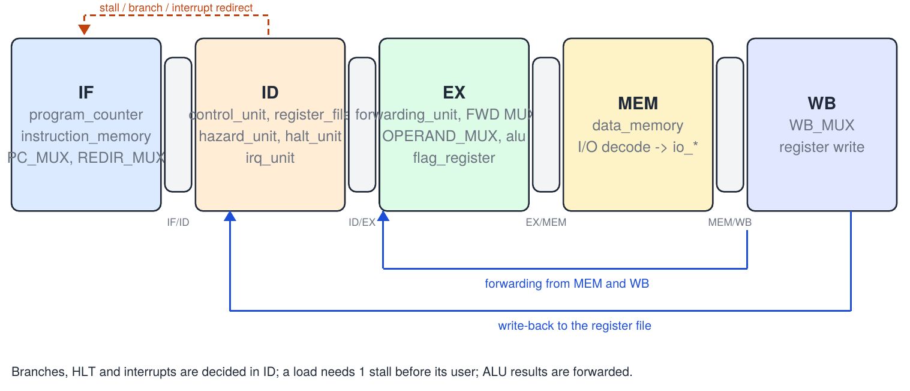

The CPU is a classic 5-stage pipeline (IF, ID, EX, MEM, WB). After 4 fill cycles it completes 1 instruction per clock. It has 8 registers `R0..R7`, a 256 x 16 instruction ROM and a 256 x 8 data RAM. Instructions use a 3-address format:

| Field | Bits | Meaning |
|---|---|---|
| `opcode` | 15:12 | 1 of 16 instructions |
| `rd` | 11:9 | destination register, or the register to store for `ST` |
| `rs1` | 8:6 | first source, the memory address for `LD` and `ST` |
| `rs2` | 5:3 | second source |
| `imm8` / `addr8` | 7:0 | constant for `LDI` and `ADDI`, target for `JMP`, `BZ` and `BNZ` |

| Opcode | Instructions | Effect |
|---|---|---|
| 0 | `NOP`, `RETI`, `EI`, `DI`, `WFI` | word `0000` is NOP, words `0001..0004` are the new system instructions |
| 1..5 | `ADD`, `SUB`, `AND`, `OR`, `XOR` | ALU, writes Z (and C for `ADD` and `SUB`) |
| 6, 7 | `SHL`, `SHR` | shift by 1 |
| 8, 9 | `LDI`, `ADDI` | load or add an 8-bit constant |
| A, B | `LD`, `ST` | register-indirect memory or I/O access |
| C, D, E | `JMP`, `BZ`, `BNZ` | jump, branch if Z = 1, branch if Z = 0 |
| F | `HLT` | stop for good |

### 3.2 Hazards, all resolved in hardware

| Hazard | Example | Solution | Cost |
|---|---|---|---|
| ALU result needed by the next instruction | `ADD R1..` then `SUB ..R1` | forwarding from MEM or WB | 0 |
| result 3 instructions later | | write-first bypass in the register file | 0 |
| load-use | `LD R1` then `ADD ..R1` | 1-clock stall, then forwarding from WB | 1 clock |
| flag | `SUB` then `BZ` | 1-clock stall, because flags are written at the end of EX | 1 clock |
| taken branch | `JMP`, `BZ`, `BNZ` | decided in ID, the 1 word fetched behind it is flushed | 1 clock |

Branches are decided in ID instead of EX to keep the penalty of a taken branch at 1 clock. The flag stall was chosen instead of forwarding the ALU zero output into ID, because that forwarding path would put the whole ALU on the branch path and lengthen the critical path.

### 3.3 New instructions: `EI`, `DI`, `RETI`, `WFI`

All 16 opcodes were already used, but `NOP` ignores its 12 low bits. The words `0001` to `0004` were therefore free, and they became the 4 system instructions. Old programs only use `0000`, so they run unchanged, and the pipeline bubble stays a NOP. The decoder only needs one extra 12-bit compare when the opcode is 0.

| Word | Instruction | Effect |
|---|---|---|
| `0001` | `RETI` (return from interrupt) | `PC <= EPC`, `IE <= 1`, Z and C restored from the shadow copy |
| `0002` | `EI` (enable interrupts) | `IE <= 1`, interrupts accepted from the next instruction |
| `0003` | `DI` (disable interrupts) | `IE <= 0`, `irq` waits and is not lost |
| `0004` | `WFI` (wait for interrupt) | the front end sleeps until `irq` |

### 3.4 Precise interrupts

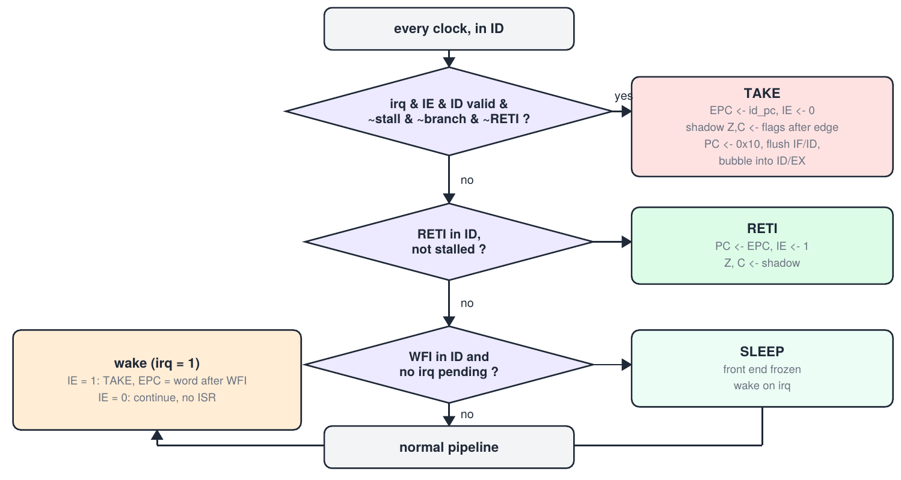

An interrupt must stop the program at a clean point, where every older instruction has finished and no younger instruction has changed anything. The instruction in ID has not changed any state yet, while the instructions in EX, MEM and WB are older. The CPU therefore takes the interrupt in ID, exactly like a taken branch.

```
take = irq & IE & (valid instruction in ID) & ~stall & ~(taken branch) & ~(RETI in ID)
     | sleeping & irq & IE
```

In the clock of `take`, the new block `irq_unit` saves the address of the instruction in ID into `EPC`, squashes that instruction, clears `IE` (no nesting), redirects the PC to the vector `0x10` and flushes IF/ID. The older instructions complete normally. `RETI` later jumps back to `EPC` and the squashed instruction runs again from the start.

The shadow copy of Z and C takes the flag value **after** the clock edge. In the take clock, the older instruction in EX may still write a flag at that same edge, and copying the stored flags would lose that update. A dedicated mutant (C1) and a dedicated coverage point (`take_with_flag_write_in_EX`) prove that this case is exercised and checked.

### 3.5 The I/O port in the MEM stage

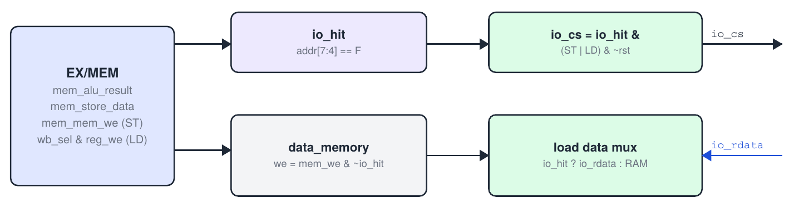

Only the MEM stage changed to integrate the peripheral.

```
io_hit = (alu_result[7:4] == 4'hF)
io_cs  = io_hit & (ST | LD) & ~rst
RAM we = mem_we & ~io_hit
load data = io_hit ? io_rdata : RAM data
```

Two properties make a read with a side effect (reading `ADC_DATA` removes a FIFO entry) safe. First, `io_cs` is gated with a real `LD` or `ST`, so an ALU instruction whose result happens to equal `0xFA` never pops the FIFO. Second, stalls only hold IF and ID, so every instruction spends exactly 1 clock in MEM, and an instruction on a wrong path is flushed before it reaches MEM. Each load of `ADC_DATA` therefore pops exactly once.

---

## 4. The peripheral

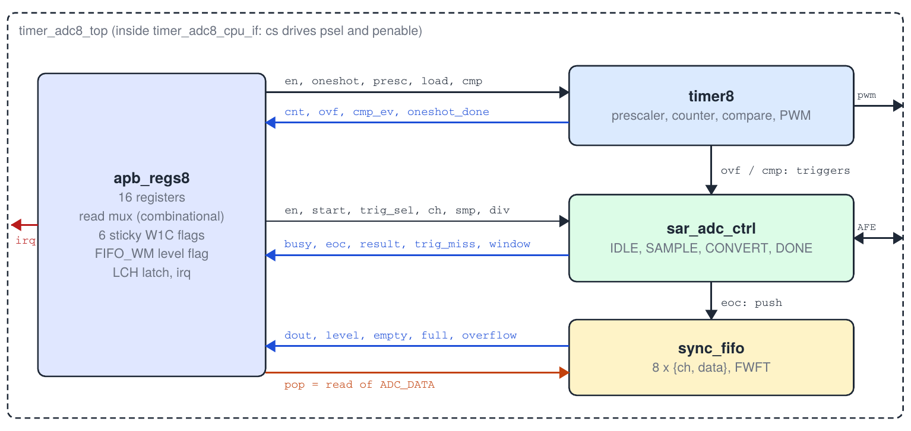

The register block `apb_regs8` is an APB slave and the only block the CPU talks to. The wrapper `timer_adc8_cpu_if` drives both `psel` and `penable` from `io_cs`, which turns every CPU access into a 1-clock APB access phase. The timer, the ADC controller and the FIFO are all controlled through register fields.

### 4.1 Register map

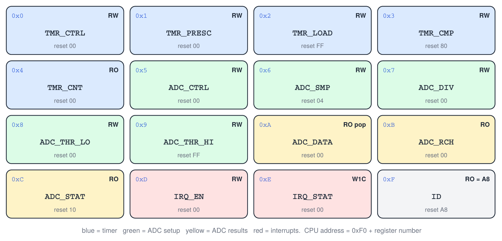

| Addr | Name | Access | Reset | Content |
|---|---|---|---|---|
| F0 | `TMR_CTRL` | RW | 00 | [0] EN, [1] ONESHOT |
| F1 | `TMR_PRESC` | RW | 00 | 1 tick every PRESC + 1 clocks |
| F2 | `TMR_LOAD` | RW | FF | count 0..LOAD, then overflow |
| F3 | `TMR_CMP` | RW | 80 | compare value, PWM duty |
| F4 | `TMR_CNT` | RO | 00 | current count |
| F5 | `ADC_CTRL` | RW | 00 | [0] EN, [1] START, [3:2] TRIG_SEL, [5:4] CH, [7:6] WM |
| F6 | `ADC_SMP` | RW | 04 | sample window of SMP + 1 ticks |
| F7 | `ADC_DIV` | RW | 00 | 1 ADC tick every DIV + 1 clocks |
| F8, F9 | `ADC_THR_LO`, `ADC_THR_HI` | RW | 00, FF | window limits, as ADC codes |
| FA | `ADC_DATA` | RO, pop | 00 | oldest result, a read removes it |
| FB | `ADC_RCH` | RO | 00 | [7] VALID, [6] LVALID, [5:4] LCH, [1:0] CH |
| FC | `ADC_STAT` | RO | 10 | [3:0] LEVEL, [4] EMPTY, [5] FULL, [6] BUSY, [7] WM |
| FD | `IRQ_EN` | RW | 00 | enables of the 7 flags |
| FE | `IRQ_STAT` | W1C | 00 | [0] TMR_OVF [1] TMR_CMP [2] ADC_EOC [3] ADC_WD [4] FIFO_OVR [5] TRIG_MISS [6] FIFO_WM |
| FF | `ID` | RO | A8 | identification |

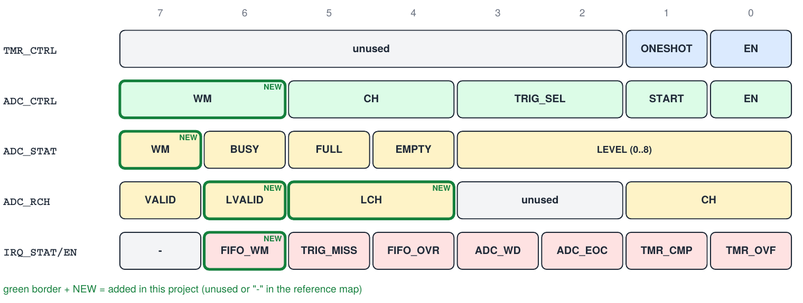

The map follows the reference specification. 4 additions (marked NEW) use bits that the specification left unused, so software written for the specification still works: a FIFO watermark threshold (`ADC_CTRL.WM`), a watermark status bit (`ADC_STAT.WM`), the channel latched by the last pop (`ADC_RCH.LVALID` and `LCH`) and a 7th interrupt source (`FIFO_WM`).

### 4.2 Timer: `timer8`

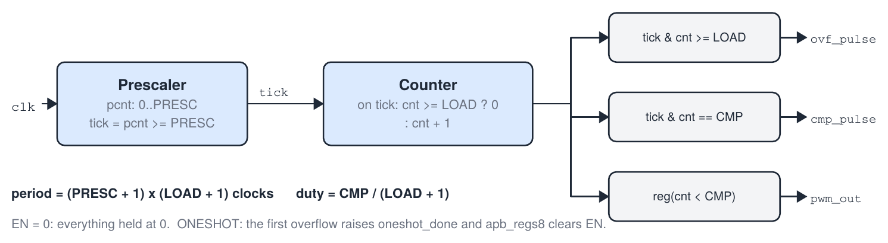

```
period = (PRESC + 1) x (LOAD + 1) clocks
duty   = CMP / (LOAD + 1)
```

The prescaler gives a `tick` every PRESC + 1 clocks, and the counter may only move in a tick clock. `ovf_pulse` fires when the count wraps and `cmp_pulse` when `cnt == CMP`. Both compares use `>=` instead of `==`, so lowering LOAD below the current count wraps at the next tick instead of counting up to 255. The PWM output is registered so that the pin never glitches, at the cost of 1 clock of delay.

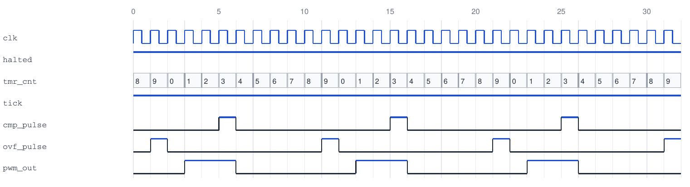

*Real waveform after `HLT`: PRESC 0, LOAD 9, CMP 3. The period is 10 clocks, compare fires at count 3 and PWM is high 3 clocks out of 10.*

### 4.3 ADC controller: `sar_adc_ctrl`

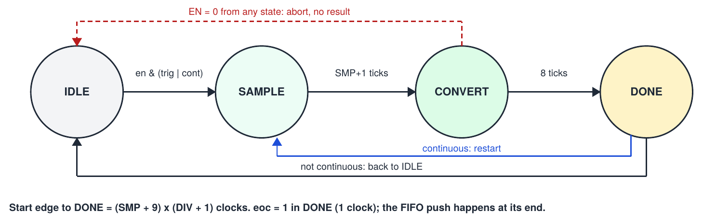

```
code            = floor(Vin x 256 / 3.3)
conversion time = (SMP + 9) x (DIV + 1) clocks
```

A SAR ADC finds the code by binary search. During SAMPLE the hold capacitor tracks the input. It then holds the voltage so that all 8 decisions describe the same value. In CONVERT, each tick tests 1 bit from the MSB down: the comparator answer `adc_cmp` keeps the bit when it is 1 and clears it when it is 0. The sequence of the 8 answers is the result.

| Bit | Trial | DAC (V) | `adc_cmp` | Decision |
|---|---|---|---|---|
| 7 | 128 | 1.650 | 0 | clear |
| 6 | 64 | 0.825 | 1 | keep |
| 5 | 96 | 1.238 | 0 | clear |
| 4 | 80 | 1.031 | 1 | keep |
| 3 | 88 | 1.134 | 0 | clear |
| 2 | 84 | 1.083 | 1 | keep |
| 1 | 86 | 1.109 | 1 | keep |
| 0 | 87 | 1.122 | 0 | clear |

*Converting 1.111 V gives 0101 0110 = 0x56 = 86.*

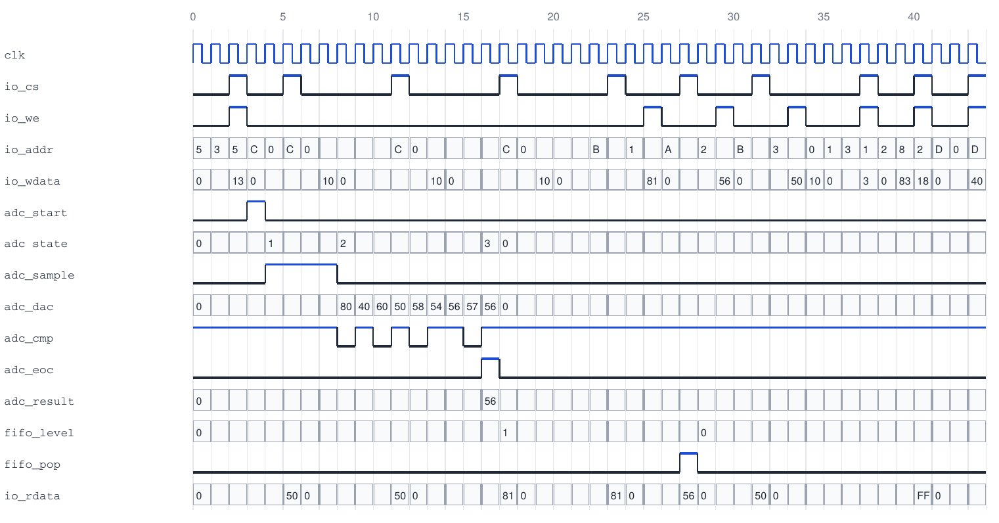

*The same conversion in the system test: the store to `ADC_CTRL`, the start pulse 1 clock later, 4 sample clocks, the 8 trials, `eoc` with result 0x56, then the load of `ADC_DATA` that pops it.*

The channel is latched at the start, so changing `ADC_CTRL.CH` during a conversion cannot mix 2 inputs. Writing `EN = 0` aborts a conversion without producing a result. A trigger that arrives while the ADC is busy is ignored and reported with the `TRIG_MISS` flag, instead of restarting the running conversion.

### 4.4 Result queue: `sync_fifo`

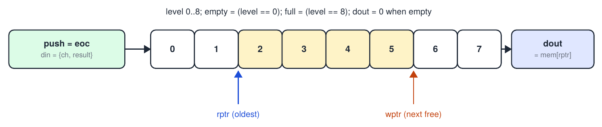

The FIFO holds up to 8 `{channel, code}` entries. It is a first word fall through design, so the oldest entry is always visible at `dout` and a read needs no extra clock.

| push | pop | State | Action |
|---|---|---|---|
| 1 | 0 | not full | write, level + 1 |
| 1 | 0 | full | drop the newest result, `FIFO_OVR` |
| 0 | 1 | not empty | read, level - 1 |
| 0 | 1 | empty | nothing, `ADC_DATA` reads 0x00 |
| 1 | 1 | any, even full | read and write, level unchanged |

When the FIFO is full, the newest result is dropped, so unread data is never overwritten.

### 4.5 Trigger and window logic: `timer_adc8_top`

| TRIG_SEL | Conversion started by |
|---|---|
| 00 | software only (START bit) |
| 01 | START or timer overflow |
| 10 | START or timer compare |
| 11 | continuous, the ADC restarts after each result |

```
adc_trig = adc_start | (TRIG_SEL == 01 & tmr_ovf) | (TRIG_SEL == 10 & tmr_cmp)
adc_wd   = adc_eoc & (result < THR_LO | result > THR_HI)
```

START works in every mode, so software can take an extra sample at any time. The window check runs once per conversion on the 8-bit code, and a code equal to a limit counts as inside the window.

### 4.6 `TRIG_MISS` is not a busy flag

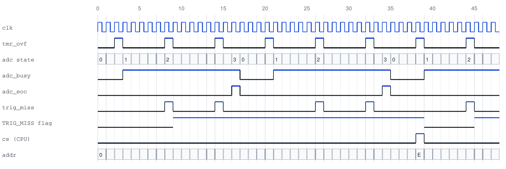

*Simulation with a timer overflow every 6 clocks and a conversion that is busy for 14 clocks. Only 1 trigger in 3 is used, the flag is set by the first miss, stays set after the conversion finishes and is cleared only by the W1C write of 0x20.*

`trig_miss = en & trig & busy`. The flag tells software that its settings lose samples, so it should make the timer period longer or the conversion shorter.

---

## 5. The interrupt mechanism end to end

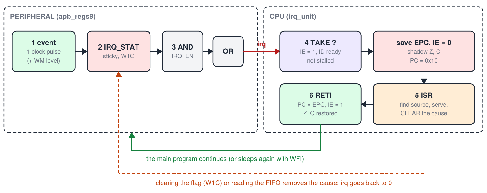

An interrupt needs both sides to agree. The peripheral decides **when** `irq` is high, through its flags and `IRQ_EN`. The CPU decides **whether** to take it, through `IE` and the state of the pipeline.

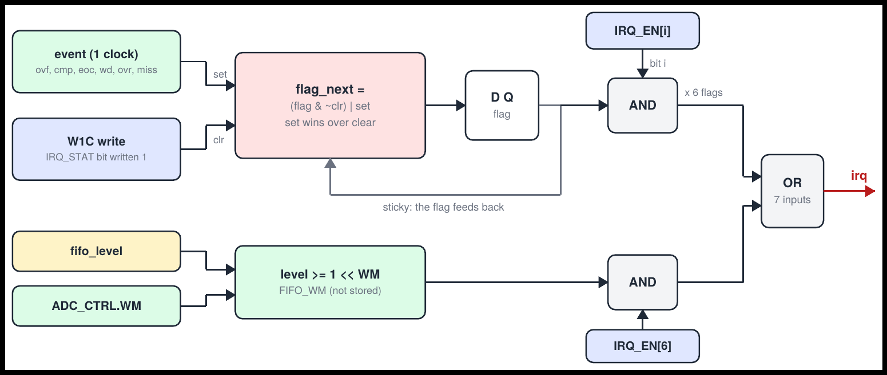

```
flag_next = (flag & ~clr) | set        (clr = data written to IRQ_STAT)
FIFO_WM   = (level >= 1 << WM)          (not stored, recomputed every clock)
irq       = OR( {FIFO_WM, flags} & IRQ_EN )
```

| Rule | Reason |
|---|---|
| events are 1-clock pulses, flags keep them (sticky) | the CPU may read `IRQ_STAT` thousands of clocks later |
| write 1 to clear (W1C) | clearing one flag never touches the others, no read, modify and write race |
| the event wins over a clear in the same clock | no event is ever lost |
| `irq` is a level, not a pulse | the CPU has no pending interrupt latch, so a pulse arriving while `IE = 0` would be lost |
| `FIFO_WM` is a level flag | it drops by itself when the ISR reads the FIFO below the threshold |

The price of a level `irq` is that the ISR must clear the cause before `RETI`. Otherwise `irq` is still high when `RETI` sets `IE`, and the CPU enters the ISR again forever.

| ISR duty | In the demo firmware |
|---|---|
| find the source | read `ADC_STAT` and `IRQ_STAT` |
| serve it | read the FIFO until it is empty |
| clear the cause | reading lowers `FIFO_WM`, then `ST 0x3F` to `IRQ_STAT` clears the sticky flags |
| keep the main program intact | the ISR only uses R5, R6 and R7, because the CPU saves the flags but not the registers |

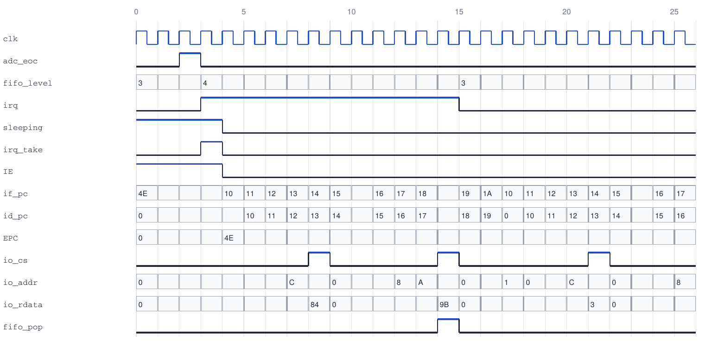

*Real waveform. The CPU sleeps in `WFI`. The 4th sample reaches the watermark, `irq` rises and the CPU takes the interrupt while asleep with `EPC = 0x4E`. The first pop lowers the level to 3 and `irq` drops by itself, 12 clocks after it rose (1 take + 7 fetches + 1 flag stall + 3 clocks for the load to reach MEM).*

---

## 6. Firmware and the system test

`asm/soc_demo.asm` is assembled by `scripts/asm8.py` and loaded into the instruction ROM. The testbench `tb_soc` treats the SoC as a product. It applies 4 analog voltages (0.40, 1.111, 2.0 and 3.0 V), releases reset and lets the CPU run until `HLT` without driving any internal signal. It then checks what the firmware stored in RAM against the ideal ADC codes.

| Part | What the firmware exercises | Expected result |
|---|---|---|
| A | read the ID register | `M[80] = A8` |
| B | software conversion of channel 1, polling, channel latch | `M[82] = 0x56`, `RCH` 0x81 before and 0x50 after the pop |
| C | timer triggered conversions, watermark interrupt, `EI`, `WFI`, ISR, `RETI` | 8 samples of 0x9B through 2 interrupts |
| D | window comparator, `THR_HI = 100`, channel 3 at 3.0 V | `IRQ_STAT = 0x4C` (WM, WD, EOC), code 0xE8 |
| F | an ALU result equal to 0xFA must not pop, then 2 pops in a row | 0x1F, 0x56, then empty |
| G | continuous mode without reading, until overflow | `IRQ_STAT = 0x54`, `ADC_STAT = 0xA8` |
| E | PWM, then `HLT` | PWM high 30 of 100 clocks |

The test also checks that no RAM byte of the I/O page was written, that exactly 2 interrupts and 2 rising edges of `irq` occurred, and that the CPU slept between 300 and 900 cycles. The measured run takes 1203 cycles with 86 I/O accesses, 2 interrupts and 743 cycles asleep.

---

## 7. Verification methodology

### 7.1 Principles

Every testbench is **self-checking**. It computes the expected values itself and prints `PASS` or `FAILED` on its last line, so the result never depends on someone reading a waveform. Waveforms are used to understand and debug, not to decide.

The methods form a pyramid. Each level answers a question that the level below cannot.

| Level | Question it answers | Method |
|---|---|---|
| Unit | is every block correct for every input it can see? | exhaustive sweeps where the input space is small, random stimulus against an independent model where it is not |
| CPU | does the pipeline behave exactly like the instruction set says, including interrupts? | lockstep against an ISA reference model on random programs |
| System | do the blocks work together under real software? | firmware on the full SoC with an analog model |
| Assertions | are the timing rules respected in every clock, even when the final result is still right? | 34 SVA rules bound to the peripheral |
| UVM | does the peripheral hold up under traffic nobody wrote by hand, and did we really reach the corners? | constrained random sequences, register model, scoreboard that predicts every clock, functional coverage |
| Mutation | would the tests notice a bug? | insert a bug, the regression must fail |

### 7.2 Choosing the method for each block

| Block | Testbench | Method | Why this method |
|---|---|---|---|
| `alu`, `control_unit`, `hazard_unit`, `forwarding_unit`, `mux2` | `tb_alu` and others | exhaustive (up to 655,360 cases) | the input space is small enough to try every combination, which leaves nothing to chance |
| `irq_unit` | `tb_irq_unit` | 512-row truth table (7 inputs x 4 states), then 20,000 random clocks against a sequential model | the decision logic is combinational and small, the state (IE, EPC, sleeping, shadow flags) needs sequences |
| `sar_adc_ctrl` | `tb_sar_adc_ctrl` | sweep of all 511 inputs (every code and every midpoint), then 3,000 random conversions, 50 aborts, 50 missed triggers | the comparator in the testbench works in 1/16 LSB, so every boundary between 2 codes is tested on both sides |
| `timer8` | `tb_timer8` | 20,000 random clocks against a cycle model, settings changed while running, directed corners | the timer state space is too large to sweep, but a cycle model predicts every output every clock |
| `sync_fifo` | `tb_sync_fifo` | 30,000 random clocks against a queue model, push and pop probabilities changed every 1,000 clocks | fixed probabilities keep the level near the middle, changing them makes the FIFO stay empty and stay full for long periods |
| `apb_regs8` | `tb_apb_regs8` | real 2-phase APB transfers, reset values, bit bashing with FF, 00, 55 and AA, then 5,000 random transfers against a shadow model | register blocks fail on access rules, so every rule is tested directly before random traffic |
| CPU | `tb_cpu`, `tb_cpu_irq` | lockstep against `isa_reference_model`, 300 and 400 random programs | a pipeline can produce correct final registers by accident, comparing every retired instruction catches the first wrong one |
| SoC | `tb_soc`, `tb_soc_sva` | firmware, analog model, end checks, assertions | the only way to test the integration, the interrupt flow and the side effect of a read together |

### 7.3 Thinking behind the tests

**Write the reference model from the specification, never from the RTL.** A model copied from the RTL shares its mistakes. The ADC model, the timer model, the queue model and the ISA model were written from the register map and the instruction table.

**Testing interrupts in lockstep.** An ISA model has no pipeline, so it cannot know when a real interrupt happens. When the CPU takes an interrupt, the testbench tells the model after how many older instructions it must take it. The model then checks that its own PC equals the `EPC` chosen by the CPU. This proves that the interrupt is precise without duplicating the pipeline in the model.

**Drive the rare cases on purpose.** Random traffic almost never produces an event and a W1C clear in the same clock, a pop in the same clock as a push into a full FIFO, or an interrupt in the exact clock in which the older instruction writes a flag. Each of these has a directed case or a dedicated coverage counter.

**Corner cases that were targeted.**

| Area | Corner cases |
|---|---|
| Timer | LOAD = 0, CMP = 0, CMP > LOAD (no compare, PWM always 1), one shot, LOAD lowered below the count, PRESC = 0 |
| ADC | codes 0 and 255, every midpoint, SMP = 0, DIV = 0 and large, abort during SAMPLE and CONVERT, trigger while busy, channel change during a conversion |
| FIFO | push while full, pop while empty, push and pop together when full, pointer wrap 7 to 0 |
| Registers | writes to read-only registers, W1C with 0 bits, event and clear in the same clock, all 4 watermark thresholds at all 9 levels |
| CPU | interrupt while stalled, during a taken branch, during `RETI`, with a flag write in EX, wake from `WFI` with `IE = 0`, `EI` and `DI` squashed by an interrupt |
| System | an ALU result equal to an I/O address, 2 loads of `ADC_DATA` back to back, stale sticky flags from a previous step |

**Every wait has a watchdog.** A broken design must fail, never hang. Mutation testing showed that 2 mutants first ended by a simulator timeout, because a testbench waited forever for an `eoc` that never came. Watchdogs were added to `tb_sar_adc_ctrl` and `tb_cpu_if`, and now all 16 mutants end with a clear FAIL message.

**Sample after the edge.** Testbench checks sample outputs a little after the clock edge, never in the same instant as the stimulus changes, which removes races between the testbench and the design.

### 7.4 SystemVerilog assertions

`sv/timer_adc_sva.sv` contains 34 concurrent assertions, for example:

| Assertion | Rule |
|---|---|
| `a_cnt_le_load` | the timer count never exceeds LOAD while enabled |
| `a_ovf_wrap` | after an overflow the count is 0 |
| `a_conv_time` | `eoc` arrives exactly (SMP + 9)(DIV + 1) clocks after the start |
| `a_sample_width` | `adc_sample` is high for exactly (SMP + 1)(DIV + 1) clocks |
| `a_hold` | without a tick, the timer count does not change |
| `a_msb_first` | the first trial of every conversion is 0x80 (MSB first) |
| `a_flag_sticky` | a flag only drops after a W1C write with that bit set |
| `a_pop_only_rd` | the FIFO only pops on a read of `ADC_DATA` |
| `a_window` | `adc_wd` equals the window equation in the `eoc` clock |

End checks catch wrong results. Assertions catch wrong behavior at the moment it happens, even when the final result is still correct, which makes them much faster to debug. They are attached with `bind` (`sv/timer_adc_bind.sv`), so the RTL contains no verification code. For simulators that mishandle `bind`, `tb/soc/tb_soc_sva.sv` instances the checker directly through hierarchical names.

Assertions only fire when the stimulus reaches the situation they describe. 3 extra mutants were run against the system test with assertions only. The timer and ADC timing mutants were caught (17 and 21 assertion failures), but an error of 1 in the window high limit passed, because the firmware never produces a code exactly equal to `THR_HI`. The UVM window test, which drives codes at LO - 1, LO, LO + 1, HI - 1, HI and HI + 1, catches it.

### 7.5 UVM environment

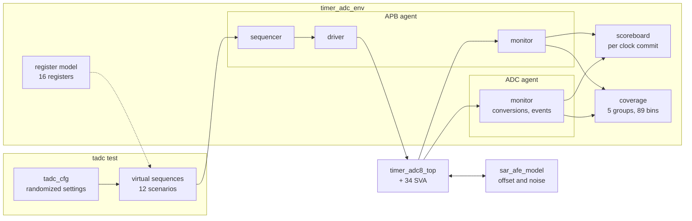

**Why UVM on top of the directed testbenches.** The directed testbenches prove each block against its specification. They cannot show that the peripheral survives combinations nobody thought of, such as a register rewritten in the middle of a conversion while the FIFO overflows. UVM adds 3 things: constrained random stimulus that explores combinations, a scoreboard that checks every read and every event automatically, and functional coverage that measures which situations were really reached.

| Component | Role and design choice |
|---|---|
| APB agent | drives real 2-phase transfers and monitors every access, so the scoreboard sees exactly what the CPU would see |
| ADC agent | monitors conversions and events, and the analog model adds offset and noise, so results are checked within a tolerance instead of against one exact code |
| Register model | names fields instead of addresses in sequences, and provides the reset values and the RW mask for the shadow state |
| `tadc_cfg` | randomizes timer and ADC settings with constraints that keep them legal and bias them toward corners (PRESC 0, LOAD 0 and 255, SMP 0, CMP > LOAD) |
| Scoreboard | keeps a model of the peripheral. The changes of one clock are collected and **committed** only when a later clock is seen, so reads, writes and events of the same clock are applied in the same order as in the RTL. It checks every read value, every ADC result, the timer period, the compare to overflow distance, overflow and the flags |
| Coverage | 5 groups kept as named counters instead of covergroups, so the same code runs on every simulator, including Verilator |

**The 12 tests.** `tadc_reg_test`, `tadc_timer_test`, `tadc_adc_sw_test`, `tadc_adc_timer_test`, `tadc_adc_cont_test`, `tadc_window_test`, `tadc_noise_test`, `tadc_trig_miss_test`, `tadc_wm_test`, `tadc_latch_test`, `tadc_random_test` and `tadc_all_test`, which runs every scenario in sequence. `tadc_all_test` checked 463 conversions, 5156 FIFO and register reads, 410 timer intervals, 23 window hits and 78 overflows with 0 errors.

| Coverage group | Bins | Result |
|---|---|---|
| ADC settings (trigger x channel, SMP and DIV ranges) | 24 | 100 % |
| ADC results (6 ranges x 4 channels) | 24 | 100 % |
| FIFO (read at every level 0 to 8, overflow, pop when empty, 4 watermarks) | 15 | 100 % |
| Timer (PRESC, LOAD and CMP ranges, one shot, events seen) | 12 | 100 % |
| Interrupts (set and clear of every flag, watermark interrupt) | 14 | 100 % |

### 7.6 Mutation testing

`scripts/mutation_soc.py` inserts one bug at a time, reruns the regression and expects a FAIL.

| # | Inserted bug | Detected by |
|---|---|---|
| P1 | timer counts one past LOAD | `tb_timer8` |
| P2 | ADC stops one bit early | `tb_sar_adc_ctrl` |
| P3 | FIFO accepts a push while full | `tb_sync_fifo` |
| P4 | W1C clear beats an event in the same clock | `tb_apb_regs8` |
| P5 | watermark off by one | `tb_apb_regs8` |
| P6 | pop also on a write to `ADC_DATA` | `tb_apb_regs8` |
| P7 | START not delayed by 1 clock | `tb_cpu_if`, `tb_soc` |
| P8 | channel not latched on the pop | `tb_apb_regs8` |
| C1 | shadow flags take the stored flags | `tb_irq_unit`, `tb_cpu_irq` |
| C2 | interrupted instruction not squashed | `tb_cpu_irq` |
| C3 | interrupt taken while stalled | `tb_irq_unit`, `tb_cpu_irq` |
| C4 | `RETI` does not restore the flags | `tb_cpu_irq` |
| C5 | wake from `WFI` always takes the interrupt | `tb_irq_unit`, `tb_cpu_irq` |
| C6 | `io_cs` not gated with `LD` and `ST` | `tb_soc` |
| C7 | RAM also written for the I/O page | `tb_soc` |
| C8 | peripheral reset not inverted | `tb_soc` |

A test suite that passes says nothing until it is shown to fail on a broken design. Each mutant is a bug a designer could plausibly write, and each one was killed by the test that targets it.

### 7.7 Bugs and lessons from debugging

| Symptom | Root cause | Lesson |
|---|---|---|
| UVM noise test failed with huge expected codes | `$urandom_range(x - 5, ...)` with an unsigned `x` below 5 wrapped around | compute with a signed temporary before any subtraction in a testbench |
| ADC results coverage stuck at 16.7 % | a ternary of string literals of different lengths produced wrong bin names | coverage also tests the testbench, a low number can be a testbench bug |
| system test read `IRQ_STAT = 0x5C` instead of 0x54 in part G | the sticky `ADC_WD` flag from part D was never cleared | clear old flags before waiting for a new event |
| 2 mutants ended by timeout | a wait for `eoc` had no limit | give every wait a watchdog |
| Vivado 2018.3 reported the checker instance twice (`VRFC 10-946`) | the old XSim applied `bind` twice | keep `bind` in its own file and provide a direct instance as an alternative |

---

## 8. Design decisions

| Decision | Alternative rejected | Reason |
|---|---|---|
| take interrupts in ID | take them in EX or MEM | ID is the last point where nothing has changed, so the interrupt is precise with the same flush logic as a branch |
| shadow flags taken after the edge | copy the stored flags | the older instruction in EX may write a flag at the same edge |
| no nested interrupts | a stack for EPC | a single `EPC` and `IE` keep the hardware small and match the use case |
| `irq` as a level | an edge or pulse | no pending latch is needed and no request is lost while `IE = 0` |
| combinational register read | registered read with a wait state | the CPU accesses memory in 1 clock, so only the MEM stage had to change |
| pop on a read of `ADC_DATA` | a separate pop register | one access per result, and safe because each instruction is in MEM for exactly 1 clock |
| FIFO overflow drops the newest | overwrite the oldest | unread data is never destroyed, and software is told through `FIFO_OVR` |
| event wins over a W1C in the same clock | clear wins | an event can never be lost |
| watermark flag computed from the level | a sticky watermark flag | it drops by itself when the ISR drains the FIFO, so the ISR needs no extra clear |
| channel latched at the start and on the pop | read the current channel | data and channel can never be mixed |
| START works in every trigger mode | START only with TRIG_SEL = 00 | software can always take an extra sample |
| new instructions inside the NOP opcode | widen the opcode | all 16 opcodes were used, and old programs and the bubble stay valid |

---

## 9. Repository structure

```
rtl/
  soc_top.v                 CPU + peripheral
  cpu/                      cpu_top and 18 modules, cpu_defs.vh, irq_unit.v (new)
  periph/                   timer8, sar_adc_ctrl, sync_fifo, apb_regs8,
                            timer_adc8_top, timer_adc8_cpu_if
sv/
  timer_adc_sva.sv          34 assertions (checker module)
  timer_adc_bind.sv         bind of the checker to timer_adc8_top
  apb_if.sv, adc_if.sv      interfaces for UVM
  sar_afe_model.sv          analog model with offset and noise (UVM)
  probe/                    7 feature probes for checking a simulator
tb/
  cpu/                      19 CPU testbenches and isa_reference_model.v
  periph/                   5 peripheral testbenches
  model/afe_model.v         analog front end model
  soc/                      tb_soc.v, tb_soc_sva.sv
  uvm/                      agents, register model, scoreboard, coverage,
                            sequences, 12 tests, tb_top.sv
asm/                        soc_demo.asm and CPU test programs
scripts/                    asm8.py, run_all.sh, run_cpu_units.sh, run_sva.sh,
                            run_uvm.sh, mutation_soc.py, file lists
docs/                       designer guide, study guides (EN, VI), images/
```

---

## 10. How to run

**Requirements.** Icarus Verilog 12 and Python 3 for the directed tests. Verilator 5 for lint and assertions. Verilator 5.04x or newer and the Accellera UVM library for the UVM regression.

```bash
sh scripts/run_all.sh                         # lint and 9 SoC, peripheral and CPU testbenches
sh scripts/run_cpu_units.sh                   # 16 CPU unit testbenches
python3 scripts/mutation_soc.py               # 16 mutants
sh scripts/run_sva.sh                         # system test with the 34 assertions (Verilator)
UVM_HOME=/path/to/uvm-core/src sh scripts/run_uvm.sh                 # 12 UVM tests
UVM_HOME=/path/to/uvm-core/src sh scripts/run_uvm.sh tadc_all_test   # one test
python3 scripts/asm8.py asm/soc_demo.asm build/soc_demo.mem          # assemble the firmware
```

**Verilator and UVM on a small machine.** The UVM build is done in 2 steps (`verilator --cc --exe --main`, then `make`), with `--output-groups 2` and `-O0` for the C++ compile. This keeps the build under about 1 GB of memory.

**Vivado.**

| Set | Files | Top |
|---|---|---|
| Design Sources | `rtl/cpu/*.v`, `rtl/cpu/cpu_defs.vh` (global include), `rtl/periph/*.v`, `rtl/soc_top.v`, `soc_demo.mem` | `soc_top` |
| Simulation, directed | `tb/cpu`, `tb/periph`, `tb/model`, `tb/soc`, `isa_reference_model.v`, the `.mem` files | any `tb_*`, for example `tb_soc` |
| Simulation, assertions | add `sv/timer_adc_sva.sv` and `tb/soc/tb_soc_sva.sv` | `tb_soc_sva` |
| Simulation, UVM (Vivado 2019.1 or newer) | `sv/*.sv` without `probe/`, `tb/uvm/timer_adc_pkg.sv`, `tb/uvm/tb_top.sv`, the other files in `tb/uvm` as headers, include path `tb/uvm`, `-L uvm` | `tb_top` |

Set `xsim.simulate.runtime` to `-all`, because the long testbenches run past the default 1000 ns. `sv/probe/run_probes.tcl` checks which SystemVerilog and UVM features the installed XSim supports.

---

## 11. Documentation

| Document | Content |
|---|---|
| `docs/SoC_Timer_ADC_Designer_Guide_SE203519.pdf` | specification, 17 design decisions, every module, interrupt theory, verification plan and results |
| `docs/RISC8_SoC_Study_Guide_EN_SE203519.pdf` | study guide in English: theory of every block, signal by signal examples from real waveforms, every testbench explained |
| `docs/RISC8_SoC_Study_Guide_VI_SE203519.pdf` | the same study guide in Vietnamese |

---

**Author:** Vu Quoc Anh (SE203519)
