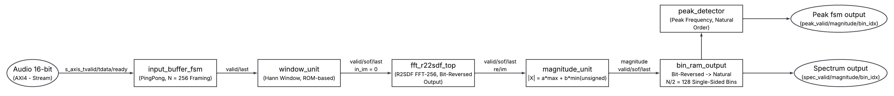
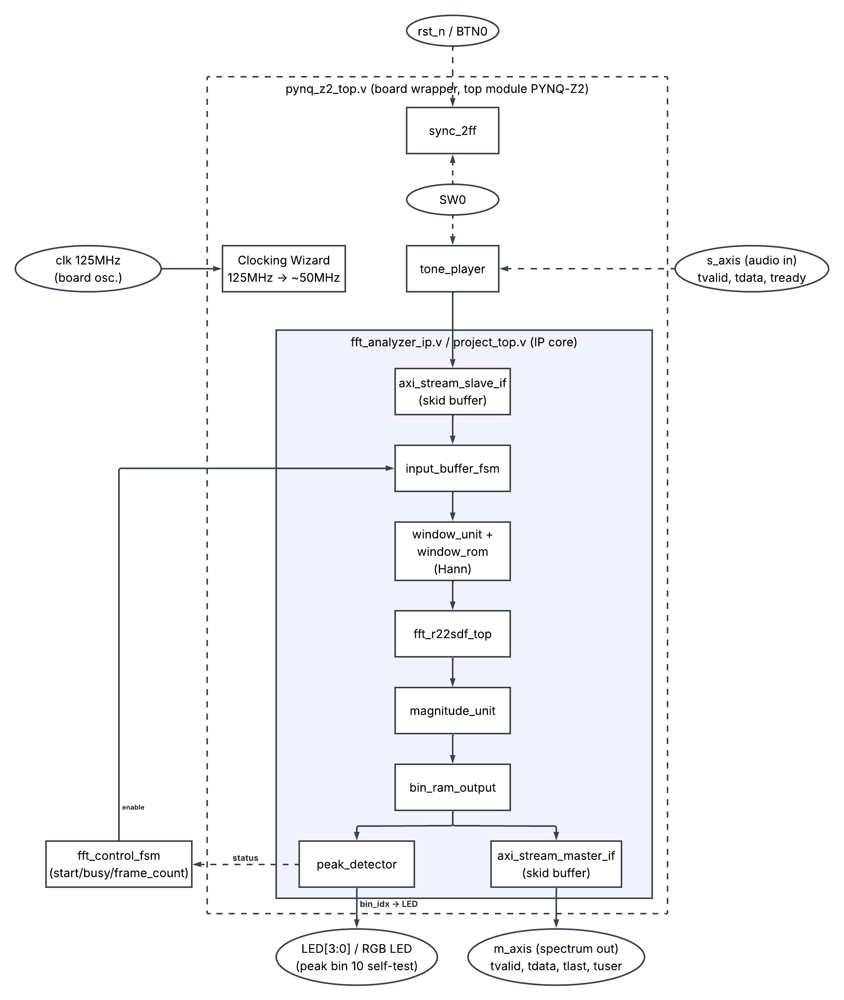
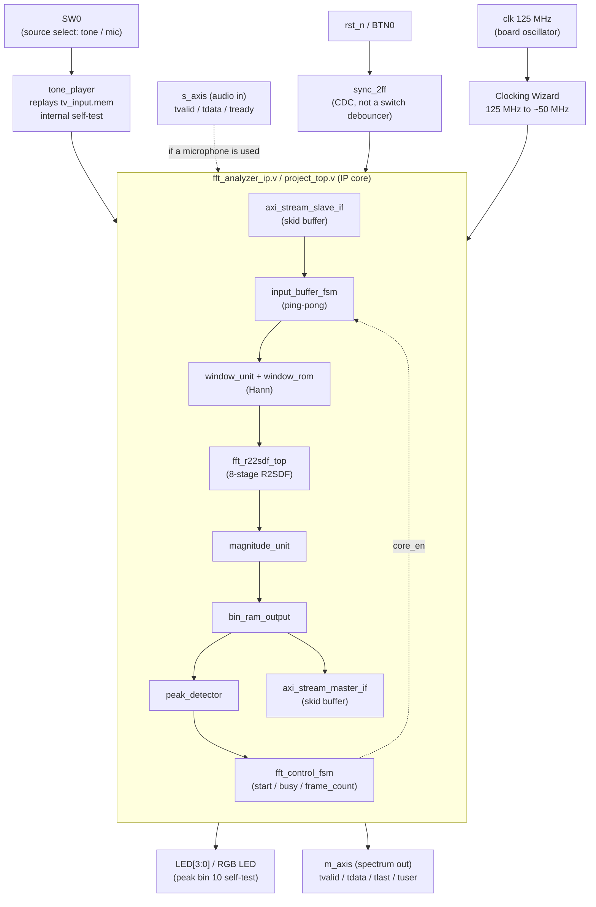
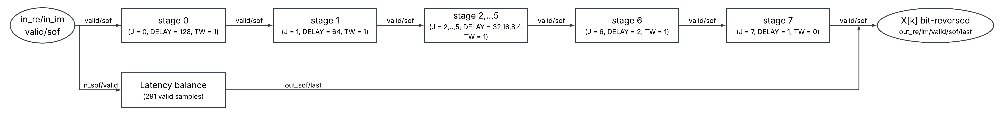
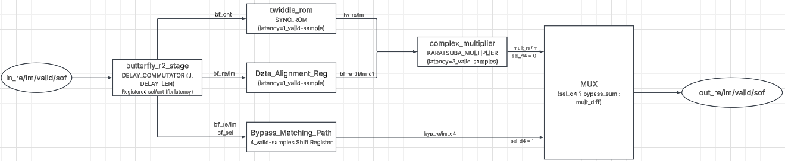

# Design and Bit-Exact Verification of a 256-Point R2SDF FFT Audio Spectrum Analyzer IP Core on PYNQ-Z2

This is a real-time audio spectrum analyzer IP core for FPGA. It is built around a 256-point
FFT in the R2SDF (Radix-2 Single-path Delay Feedback) architecture, uses Q1.15 fixed-point
arithmetic, and has AXI4-Stream interfaces on both ends. It was developed as a coursework
project for COS201 (Communication Systems).

The target board is the Digilent PYNQ-Z2 (Zynq XC7Z020CLG400-1). The design has been
synthesized and implemented, timing has been closed, and a bitstream is available at
`bitstream/pynq_z2_top.bit`.

-blue)


---

## Table of Contents

- [Overview](#overview)
- [Results at a Glance](#results-at-a-glance)
- [Processing Chain](#processing-chain)
- [Top Level Module](#top-level-module)
- [FFT Core Architecture](#fft-core-architecture)
- [Module Reference](#module-reference)
- [Key Design Decisions](#key-design-decisions)
- [Interface Specification](#interface-specification)
- [Repository Structure](#repository-structure)
- [Verification: RTL vs. Python Golden Model](#verification-rtl-vs-python-golden-model)
- [PPA Results](#ppa-results)
- [Board Bring Up](#board-bring-up)
- [Authors](#authors)

---

## Overview

This core computes a 256-point FFT of a streaming audio signal and reduces each transform to a
128-bin single sided magnitude spectrum, together with the spectral peak of each frame. It is
intended for embedded spectral front ends (keyword spotting, acoustic event detection, machine
condition monitoring, and instrumentation) on devices where the FFT is not instantiated from a
vendor library but is itself the object of study.

The architecture is deliberately conventional. It uses Cooley-Tukey decimation in frequency,
an SDF pipeline, Q1.15 fixed-point arithmetic with scaling at every stage, a complex product
that needs only three multiplications, a Hann window, and an α-max-β-min magnitude estimator.
What this repository offers instead is a fully open RTL description paired with a bit accurate
Python model that both *generates its coefficient memories* and *serves as its verification
oracle*. It also offers a bit-exact verification result at every level of the hierarchy,
obtained from the bottom up, and a PPA characterization after place-and-route that separates
measured numbers from derived ones.

---

## Results at a Glance

| Metric | Value | Basis |
|---|---|---|
| Functional correctness | Bit-exact vs. Python oracle at all 7 levels | Measured (simulation) |
| Core SQNR vs. golden model | 204.6 dB, which indicates zero absolute error | Measured |
| Fixed-point SQNR, Q1.15 vs. float64 | 58 to 61.6 dB across seeds, with a slope of 6.02 dB/bit | Measured and rederived |
| Python model vs. `numpy.fft` | Agreement to about 1e-16 | Measured |
| Slice LUT | 4 432 (8.33 %) | Report after P&R |
| Slice Register | 4 328 (4.07 %) | Report after P&R |
| Slice | 1 882 (14.15 %) | Report after P&R |
| Block RAM | 7.5 tiles (5.36 %) | Report after P&R |
| DSP48E1 | **24** (10.91 %), which matches the analytic model exactly | After P&R, and derived |
| Board timing | WNS **+2.510 ns**, timing met at 49.98 MHz | Report after routing |
| Throughput | 1 sample per enabled clock, or about 195 k transforms/s at 50 MHz | Derived |
| Real-time margin | About **1040×** above the 48 kS/s requirement | Derived |
| Core latency | **291 valid samples**, constant in every frame | Measured and decomposed analytically |


---

## Processing Chain



`input_buffer_fsm` (N=256 frame buffering, AXI4-Stream protocol) → `window_unit` (Hann
window) → `fft_r22sdf_top` (256-point R2SDF FFT, bit reversed output) → `magnitude_unit`
(spectral magnitude) → `bin_ram_output` (reordering to natural sequence, N/2 = 128 bins).
The chain then branches in parallel into the full spectrum (`Spectrum output`) and the
spectral peak found by `peak_detector` (`Peak fsm output`).

- The mapping from bin to frequency is `f_k = k · f_s / N`. With `f_s = 48 kHz`, this gives
  **187.5 Hz per bin** over a 128-bin single sided spectrum, since the audio input is real
  valued.
- Output framing follows a `sof` / `valid` / `last` protocol in which each sample carries a
  label of its own position within the frame, so no explicit address bus is used.

---

## Top Level Module

`pynq_z2_top.v` is the module that is actually programmed onto the board. It wraps the IP core
(`fft_analyzer_ip.v` / `project_top.v`) and adds infrastructure specific to the board, namely a
Clocking Wizard, clock domain crossing, and an internal self test source. The self test source
is needed because the PYNQ-Z2 has no onboard PDM microphone.



- `tone_player` replays `tv_input.mem` as an internal stimulus. This is the same golden test
  vector used in simulation, and its spectral peak sits at **bin 10** (1875 Hz). It confirms
  that the whole chain runs correctly on real silicon before any external audio source is
  needed.
- The Clocking Wizard divides the 125 MHz board oscillator down to about 50 MHz for the main
  clock domain of the design (see [PPA Results](#ppa-results)).

<details>
<summary>English text source version of the same diagram (rendered natively on GitHub)</summary>


</details>

---

## FFT Core Architecture

### Eight R2SDF stages

Stage *J* owns a feedback delay line of `DELAY_LEN = N >> (J+1)` complex words (128, 64, 32,
16, 8, 4, 2, 1), so the delay lines require `N − 1 = 255` words in total. This is the
theoretical minimum memory for a pipelined FFT. The final stage sets `TW = 0`
(`HAS_TWIDDLE = 0`) because W⁰ = 1, which leaves seven general complex multipliers.




### Inside one stage

Each stage contains a delay commutator butterfly, a synchronous twiddle ROM, a Karatsuba
complex multiplier that uses three multiplications, and a bypass path for the sum stream. The
delays of the two branches are matched exactly, as follows.

- The twiddle branch is the ROM (1 cycle) plus the complex multiplier (3 cycles), which gives 4 valid samples.
- The bypass branch is a matched shift register of 4 valid samples.




If the pipeline depth of the complex multiplier changes from 3 to *P*, the bypass path must
become `1 + P`, and the top level `FFT_LATENCY` parameter must be recomputed.

---

## Module Reference

| Module | Role | Technique / algorithm |
|---|---|---|
| `butterfly_r2_stage` | Add/subtract butterfly with a delay commutator | Internal delay line `DELAY_LEN = N>>(J+1)` (128…1), ÷2 scaling per stage, convergent rounding (round-half-to-even), and saturation |
| `twiddle_rom` | Twiddle factors $W_N^k$ | Synchronous ROM with N/2 coefficients and a 1-cycle read |
| `complex_multiplier` | Complex multiplication | Karatsuba method with 3 real multiplies instead of 4, in a 3-stage pipeline that gives a latency of 3 valid samples |
| `stage_with_twiddle` | One assembled FFT stage | A 4-cycle twiddle branch in parallel with a 4-cycle bypass branch of matched delay, with the MUX driven by a correctly delayed `sel_o` |
| `fft_r22sdf_top` | Eight assembled stages | 256-point DIF FFT with a throughput of 1 sample/cycle and bit reversed output |
| `window_unit` + `window_rom` | Windowing | Hann window applied before the FFT to reduce spectral leakage |
| `magnitude_unit` | Spectral magnitude | α-max-β-min approximation (α = 31471, β = 13036) used in place of `sqrt(re²+im²)`, which is expensive in resources |
| `bin_ram_output` | Reordering | Converts bit reversed order to natural order and folds the symmetric spectrum to N/2 = 128 single sided bins |
| `peak_detector` | Peak search | Running comparison within one frame, which emits `peak_magnitude` and `peak_bin_idx` |
| `input_buffer_fsm` | Frame buffering | Ping-pong buffer with N = 256, which inserts one bubble cycle between frames |
| `axi_stream_slave_if` / `axi_stream_master_if` | IP boundary | Skid buffer that honours `tready` / `tvalid` backpressure |
| `fft_control_fsm` | Control | `start` / `busy` / `core_en` / `frame_count` |


---

## Key Design Decisions

Valid gating from end to end (`en`). Every block (ROMs, complex multipliers, and framing delay
lines) carries an enable tied to `valid`. The pipeline therefore advances in the sample
domain rather than the clock domain, and all latency figures are quoted in valid samples. This
makes the bubble between frames transparent, and it lets the core run from an arbitrarily
sparse source. For example, 48 kS/s on a 50 MHz fabric corresponds to one sample per about
1042 cycles, and this needs no FIFO, no rate matcher, and no change to the handshake.

The ÷2 scaling per stage (1/N overall after 8 stages) is mandatory to prevent Q1.15 overflow.
The effect is dramatic and worth stating quantitatively. Without scaling, SQNR collapses to
**~1.5 dB** because overflow noise dominates, while with scaling, SQNR is **~60 dB**. Because
`|a ± b|/2 ≤ max(|a|, |b|)`, the schedule makes overflow structurally impossible rather than
merely unlikely.

Number formats. Complex data uses signed Q1.15, the magnitude uses unsigned 16-bit, and the
approximate `log2` output (optional, `ENABLE_LOG`) uses Q8.8.

---

## Interface Specification

The full details are in `docs/interface_spec.md`. A summary is given below.

| Parameter | Default | Meaning |
|---|---|---|
| `N` | 256 | FFT size (samples per frame) |
| `DATA_WIDTH` | 16 | Width of each sample or bin (Q1.15) |
| `FFT_LATENCY` | **291** | Core latency in valid samples |
| `ENABLE_LOG` | 1 | Emit `out_mag_log2` (Q8.8, approximate log2) |

Both the AXI4-Stream slave (audio in) and the master (spectrum out) implement `tvalid` / `tready`
backpressure through a skid buffer. The spectrum output is single sided and in natural order,
with `tuser[0]` marking the start of the frame and `tlast` marking the final bin (N/2 − 1).

---

## Repository Structure

```
rtl/
  core/           # FFT core: butterfly, twiddle ROM, complex multiplier, R2SDF top
  system/         # Pre/post-processing + IP integration: window, magnitude, bin reorder,
                  # peak detector, control FSM, project_top, fft_analyzer_ip
  interfaces/     # axi_stream_slave_if / axi_stream_master_if
  board/          # PYNQ-Z2 board wrapper: pynq_z2_top, tone_player, sync_2ff
tb/
  tb_fft_r22sdf.v # FFT core testbench (sweeps offset, self-measures latency)
  tb_top.sv       # System-level testbench (SystemVerilog)
  unit_tests/     # Dedicated testbenches for 4 modules: twiddle_rom, butterfly,
                  # magnitude, bin_ram
python/
  gen_*.py, compare_sqnr.py   # Generate ROMs/golden vectors + SQNR comparison
  unit_test_gen/              # golden_model_fft.py + vector generation for the 4 unit tests
sim/
  vectors/              # System-level golden vectors (.mem)
  unit_test_vectors/    # Per-module golden vectors (.mem/.txt)
constraints/       # pynq_z2.xdc, timing_only.xdc
docs/
  images/           # flow_diagram.png, top_module_diagram.png,
                    # fft_core_stages.png, r2sdf_stage.png
  reports/          # Vivado timing/utilization reports (post-P&R)
  interface_spec.md # Full IP port specification
bitstream/
  pynq_z2_top.bit  # Built bitstream, ready to program
```

Because `golden_model_fft.py` *generates* the `.mem` files that initialise the ROMs, a
coefficient mismatch between the model and the hardware is structurally impossible. This is
deliberate, and it eliminates an entire class of verification failure.

---

## Verification: RTL vs. Python Golden Model

Verification proceeds from the bottom up, one block at a time. Each RTL module is checked for
bit-exact agreement with a cycle accurate Python golden model (`golden_model_fft.py`) before
the FFT core and then the full system are checked. Each level uses the stimulus that exercises
the particular failure mode of that block. Random vectors are used where the operator is
combinational and its error surface is smooth, exhaustive enumeration is used where the state
space is small enough, and cycle accurate comparison is used where control and data must stay
aligned.

| Verification level | Result |
|---|---|
| `twiddle_rom` (128 addresses + 2 mathematical anchors) | **PASS**, bit-exact |
| `butterfly_r2_stage` (1024 cycles, 4 frames) | **PASS**, bit-exact, with `sel_o`/`cnt_o` correct on every cycle |
| `complex_multiplier` (Karatsuba, 200 000 random vectors) | **PASS**, bit-exact vs. direct complex multiplication |
| `magnitude_unit` (2013 pairs: 13 boundary + 2000 random) | **PASS**, bit-exact magnitude and approximate log2 |
| `bin_ram_output` (1164 cycles, 4 frames) | **PASS**, bit-exact, with bit reversal correct for 128/128 bins |
| `fft_r22sdf_top` (complete FFT core) | **PASS**, **SQNR = 204.6 dB**, peak bin = 10 |
| Full system (`tb_top`, 8 consecutive frames) | **PASS**, `peak_bin` = **10** on every frame |

Conclusions.

- The RTL matches the Python golden model bit-exactly across all submodules.
- At the core and system levels, the fixed-point error (Q1.15 with ÷2 scaling per stage)
  yields **SQNR ≈ 58 to 61.6 dB** across many random seeds, with no overflow, and the spectral
  peak bin is always identified correctly (bin 10, which matches the injected tone).
- The Karatsuba complex multiplier with 3 multiplications is bit-exact against direct complex
  multiplication (0 differences over 200 000 trials).
- The floating-point Python model agrees with `numpy.fft` to within about 1e-16.

### What "SQNR = 204.6 dB" means

This figure does not mean that the core has 204.6 dB of dynamic range. It means that the error
between the RTL and the golden model was *identically zero*, and 204.6 dB is the value to which
the SQNR expression clamps when the denominator is a floor value rather than a real error. It
should be read as a pass or fail flag for bit-exactness, not as an accuracy figure. The honest
measure of fixed-point accuracy is the **58 to 61.6 dB** measured against a floating-point
reference.

### Independent rederivation

For the accompanying paper, a second bit accurate model was written from scratch, independently
of `golden_model_fft.py`. It reproduced the following results: an SQNR slope of 6.02 dB/bit,
58.97 dB at Q1.15, 0 mismatches in 400 000 comparisons between the Karatsuba and direct
methods, the analytic count of 24 DSP blocks, the ±3.96 % equiripple bound of the α-max-β-min
estimator, and the 1.5-bin ENBW and 3.185 dB worst case processing loss of the Hann window.

---

## PPA Results

These results were obtained with Vivado 2020.2+ for the PYNQ-Z2, after Place & Route, for the
full `pynq_z2_top` build.

| Resource | Used | Available | Utilisation |
|---|---:|---:|---:|
| Slice LUT | 4 432 | 53 200 | 8.33 % |
| Slice Register | 4 328 | 106 400 | 4.07 % |
| Slice | 1 882 | 13 300 | 14.15 % |
| Block RAM (tile) | 7.5 | 140 | 5.36 % |
| DSP48E1 | **24** | 220 | 10.91 % |

Source reports: `docs/reports/pynq_z2_top_utilization_placed.rpt`,
`docs/reports/pynq_z2_top_timing_summary_routed.rpt`.

The DSP count admits an exact analytic prediction, and the fact that the two *match* is a
useful cross check in both directions. It confirms that no multiplier was inferred where none
was intended and that none was optimised away into logic.

```
N_DSP = 3·(log2 N − 1) + 2 + 1 = 3×7 + 3 = 24
        └ 7 complex mults    │   └ window unit
                             └ magnitude unit (alpha, beta)
```

Timing. The main clock after the Clocking Wizard runs at **49.98 MHz** with
WNS = **+2.510 ns**, which means that timing is met with margin. The implied critical path is
20.008 − 2.510 = 17.498 ns, which gives F<sub>max</sub> ≈ **57 MHz**.

> F<sub>max</sub> should be interpreted with care. The value of 57 MHz is derived from a
> *satisfied* constraint. Once a constraint is met, the tool stops optimising, so this figure
> bounds the constraint rather than the capability of the design. Earlier runs under tighter,
> *failing* constraints imply a somewhat higher ceiling (≈ 62 to 64 MHz). Neither number is a
> hard limit. The critical path lies in `magnitude_unit`, and a pipelined variant of that block
> is the obvious next step.

<details>
<summary>Note on an earlier and lower set of utilisation numbers</summary>

Some earlier project documentation reports ≈ 6 % LUT, 2 % FF, 3 % BRAM, and WNS +1.732 ns.
Those figures come from an out-of-context characterization of the IP core alone, using
`constraints/timing_only.xdc` with no pin assignment. This is also why that run reports
~79 % IOB utilisation, which is an artefact of promoting every port to a package pin.

The table above is for the full board build, which additionally contains the Clocking Wizard,
`tone_player` (with its own stimulus ROM, which explains much of the extra block RAM),
`sync_2ff`, and the LED logic. The DSP count is identical at 24 in both, as expected, because
the wrapper adds no multipliers.

Both are valid measurements of different things. The full build numbers should be quoted for
"what it costs on this board" and the out-of-context numbers for "what the IP costs
standalone", and it should always be stated which is which.
</details>

---

## Board Bring Up

1. Program `bitstream/pynq_z2_top.bit`, and then press BTN0 to reset.
2. Set SW0 = 0 (source = internal `tone_player`). Then `led[3:0]` must read **`1010`**
   (peak bin = 10 = `0001010`).
3. A green RGB LED means busy, and the RGB LED blinks red on each completed frame.
4. If the bin is not 10, the most likely cause is a wrong `FFT_LATENCY` in `pynq_z2_top.v`.
   In that case, rerun `tb_fft_r22sdf` to read the *measured* latency, and correct the
   parameter to match it.

> The PYNQ-Z2 has no onboard PDM microphone, so the current wrapper uses only the internal
> self test source (`tone_player`). This source has been confirmed to work on real silicon
> (peak bin = 10).

Practical notes. The project path must not contain spaces or accented characters, because
elaboration of the `clk_wiz_0` IP fails with `[IP_Flow 19-1747]` / `[Common 17-165]` on such
paths. After editing any `.v` file, reset the runs (`synth_1`, `impl_1`) before running
implementation again, since stale caches have produced misleading timing results here before.
Testbenches belong in Simulation Sources, not Design Sources, or synthesis may silently select
the wrong top module. The active constraint file is `pynq_z2.xdc`, while `timing_only.xdc` is
for standalone PPA measurement and does not produce a board bitstream.

---

## Authors

Anh Quoc Vu · Hung Dong Truong · Hoang Nguyen Huy Le · Minh Duy Nguyen ·
Duyen Vu Ky Nguyen · Loc Duy Lam

Please open an [issue](../../issues) for questions, bug reports, or reproduction problems.

---

## License

TBD. A `LICENSE` file should be added before publishing. MIT or Apache-2.0 is conventional for
open RTL. Note that the coefficient `.mem` files are generated by the scripts in `python/` and
inherit whichever licence is chosen.
